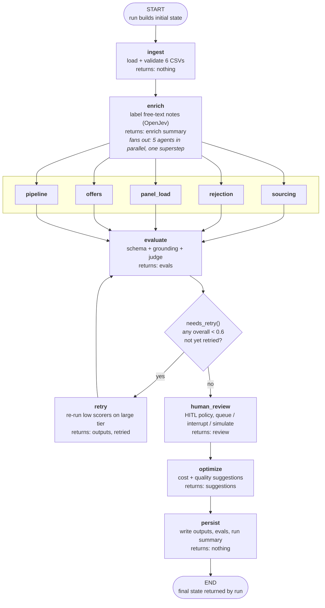
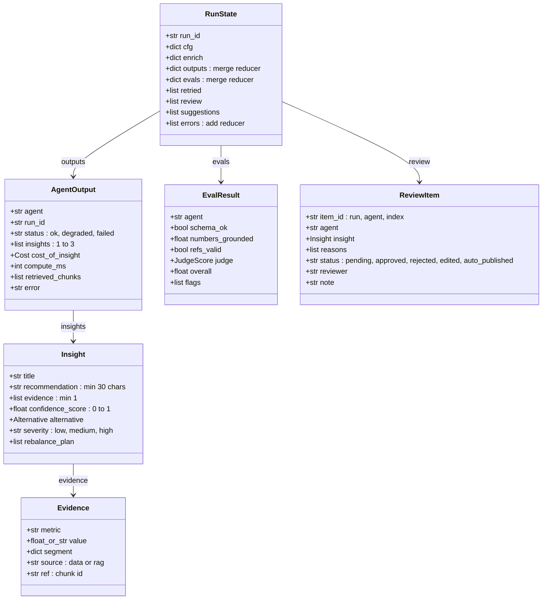
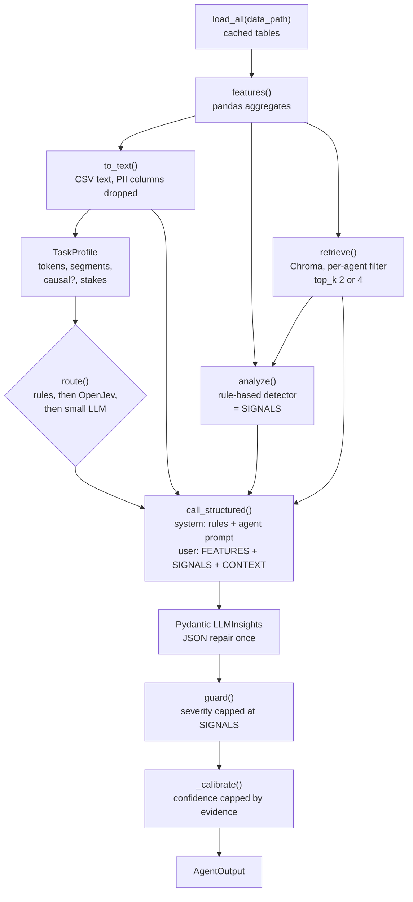
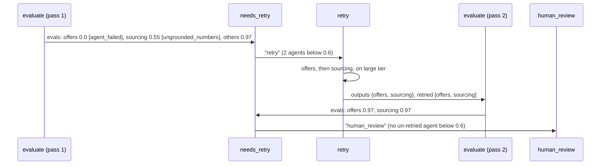
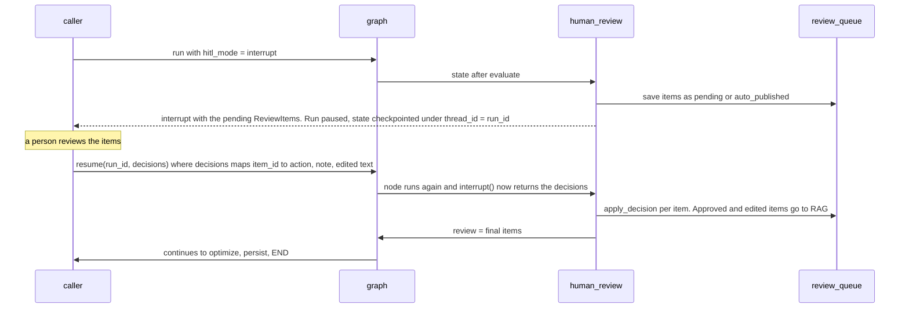

# 13 — The LangGraph orchestrator

**Goal:** wire everything into one graph with parallel agents, a retry loop, a human-review pause, and error handling at every hop. Plus a CLI to run it.

**Time:** 1 hour.

## Concepts

```text
START -> ingest -> enrich -> [sourcing | rejection | panel_load | offers | pipeline] -> evaluate
      evaluate --(any score < 0.6, not yet retried)--> retry (large tier) -> evaluate
      evaluate --(otherwise)--> human_review -> optimize -> persist -> END
```

- **Fan-out / fan-in.** Five edges from `enrich` run the agents in parallel; five edges into `evaluate` wait for all of them.
- **Reducers.** `outputs` and `evals` merge dicts so parallel nodes don't overwrite each other; `errors` concatenates lists.
- **Checkpointable state.** Only paths, config and JSON-able dicts live in state, so `InMemorySaver` (or SQLite) can pause the graph at `human_review` and resume it later.
- **Retry once.** `retried` stops a loop: an agent gets at most one retry on the large model.
- **Demo switches** prove the error handling: `crash_agent="offers"` (the agent raises, the run recovers on retry) and `inject_fault="sourcing"` (invented numbers, which the evaluator catches before the retry).

| Hop | Failure | Handling |
| --- | --- | --- |
| ingest | missing table / column | hard fail with a clear message |
| enrich | low-confidence label | `unclassified`, never forced |
| retrieval | empty / Chroma error | continue, status `degraded`, confidence capped |
| LLM | timeout / 429 / bad JSON | LiteLLM retries, one repair turn, then `failed` |
| agent | any exception | `failed` output, recorded in `errors` |
| evaluate | score < 0.6 | one retry on the large model |
| A2A | remote task fails | `failed` output with task id and state |

## Step 13.1 — The graph

**File:** `hiring_intel/graph.py`
```python
"""LangGraph orchestrator.

ingest -> enrich (OpenJev) -> 5 insight agents in parallel -> evaluate -> [retry low scorers on large]
       -> human_review (HITL) -> optimize -> persist

State carries only paths, configs and JSON-able dicts, so it can be checkpointed (needed for HITL
interrupt/resume). A failed agent writes a 'failed' output instead of raising.
"""
from __future__ import annotations

import datetime as dt
import operator
import time
import uuid
from typing import Annotated, TypedDict

from langgraph.checkpoint.memory import InMemorySaver
from langgraph.graph import END, START, StateGraph
from langgraph.types import Command, interrupt

from hiring_intel import hitl
from hiring_intel.agents.evaluator import evaluate_one
from hiring_intel.agents.insight_agents import AGENTS
from hiring_intel.agents.optimizer import optimize
from hiring_intel.contracts import AgentOutput, Evidence, ReviewItem
from hiring_intel.enrich import enrich
from hiring_intel.ingest import load_all
from hiring_intel.observability import execute, log_timing, purge_run
from hiring_intel.openjev import decider


def merge(old: dict | None, new: dict | None) -> dict:
    return {**(old or {}), **(new or {})}


class RunState(TypedDict, total=False):
    run_id: str
    cfg: dict
    enrich: dict
    outputs: Annotated[dict, merge]
    evals: Annotated[dict, merge]
    retried: list[str]
    review: list[dict]
    suggestions: list[dict]
    errors: Annotated[list, operator.add]


def _ms(t0: float) -> int:
    return int((time.perf_counter() - t0) * 1000)


# ------------------------------------------------------------------ nodes
def ingest_node(s: RunState):
    t0 = time.perf_counter()
    load_all(s["cfg"]["data_path"])
    log_timing(s["run_id"], "ingest", "-", _ms(t0), 0)
    return {}


def enrich_node(s: RunState):
    t0 = time.perf_counter()
    info = enrich(load_all(s["cfg"]["data_path"]), s["run_id"], decider(), mode=s["cfg"]["classify"])
    log_timing(s["run_id"], "enrich", "-", _ms(t0), 0)
    return {"enrich": info}


def _run_agent(name: str, s: RunState, force_tier: str | None = None, last_eval: float | None = None) -> AgentOutput:
    cfg = s["cfg"]
    if cfg.get("crash_agent") == name and not force_tier:
        return AgentOutput(agent=name, run_id=s["run_id"], status="failed", error="RuntimeError: injected crash")
    if cfg.get("transport") == "a2a":
        from hiring_intel.a2a import call_agent
        out = call_agent(name, {"data_path": cfg["data_path"], "run_id": s["run_id"], "force_tier": force_tier
                                or cfg.get("force_tier"), "compress": cfg["compress"], "use_cache": cfg["use_cache"],
                                "last_eval": last_eval})
    else:
        out = AGENTS[name].run(load_all(cfg["data_path"]), s["run_id"], force_tier=force_tier or cfg.get("force_tier"),
                               compress=cfg["compress"], use_cache=cfg["use_cache"], last_eval=last_eval)
    if cfg.get("inject_fault") == name and not force_tier and out.insights:
        # fabricated numbers: the evaluator should catch them and trigger a retry on the large model
        for ins in out.insights:
            ins.evidence += [Evidence(metric="industry_hire_rate", value=v, segment={"note": "invented"})
                             for v in (0.777, 0.913, 0.4242)]
    return out


def make_agent_node(name: str):
    def node(s: RunState):
        out = _run_agent(name, s)
        llm = out.cost_of_insight.latency_ms if out.cost_of_insight else 0
        log_timing(s["run_id"], "agents", name, out.compute_ms, llm)
        errs = [f"{name}: {out.error}"] if out.status == "failed" else []
        return {"outputs": {name: out.model_dump()}, "errors": errs}
    return node


def evaluate_node(s: RunState):
    t0 = time.perf_counter()
    data = load_all(s["cfg"]["data_path"])
    todo = [a for a in s["outputs"] if a not in s.get("evals", {}) or a in s.get("retried", [])]
    res = {}
    for a in todo:
        out = AgentOutput.model_validate(s["outputs"][a])
        res[a] = evaluate_one(AGENTS[a], out, data, s["run_id"], s["cfg"]["compress"]).model_dump()
    log_timing(s["run_id"], "evaluate", "-", _ms(t0), 0)
    return {"evals": res}


def needs_retry(s: RunState) -> str:
    low = [a for a, r in s["evals"].items() if r["overall"] < 0.6 and a not in s.get("retried", [])]
    return "retry" if low else "human_review"


def retry_node(s: RunState):
    low = [a for a, r in s["evals"].items() if r["overall"] < 0.6 and a not in s.get("retried", [])]
    new = {}
    for a in low:                                      # sequential here; small number of agents
        out = _run_agent(a, s, force_tier="large", last_eval=s["evals"][a]["overall"])
        log_timing(s["run_id"], "retry", a, out.compute_ms, out.cost_of_insight.latency_ms if out.cost_of_insight else 0)
        new[a] = out.model_dump()
    return {"outputs": new, "retried": s.get("retried", []) + low}


def human_review_node(s: RunState):
    t0 = time.perf_counter()
    outs = {a: AgentOutput.model_validate(o) for a, o in s["outputs"].items() if o["status"] != "failed"}
    items = hitl.build_queue(s["run_id"], outs, s["evals"])
    mode = s["cfg"]["hitl_mode"]
    pend = [i for i in items if i.status == "pending"]
    if pend and mode == "interrupt":
        # pauses the graph; the caller resumes with Command(resume={item_id: {"action":..., "note":...}})
        decisions = interrupt({"pending": [i.model_dump() for i in pend]})
        for iid, d in (decisions or {}).items():
            hitl.apply_decision(iid, d.get("action", "approved"), d.get("reviewer", "human"), d.get("note", ""),
                                d.get("edited_recommendation"))
    elif pend and mode == "simulate":
        for i in pend:
            act, note = hitl.simulated_reviewer(i, s["evals"].get(i.agent, {}).get("overall", 0))
            hitl.apply_decision(i.item_id, act, "simulated-policy", note)
    log_timing(s["run_id"], "human_review", "-", _ms(t0), 0)
    final = [ReviewItem.model_validate_json(j).model_dump() for j in
             hitl.query("SELECT json FROM review_queue WHERE run_id=?", (s["run_id"],)).json]
    return {"review": final}


def optimize_node(s: RunState):
    t0 = time.perf_counter()
    sug = optimize(s["run_id"], s["evals"])
    log_timing(s["run_id"], "optimize", "-", _ms(t0), 0)
    return {"suggestions": [i.model_dump() for i in sug]}


def persist_node(s: RunState):
    import json
    rid = s["run_id"]
    for a, o in s["outputs"].items():
        execute("INSERT INTO agent_outputs VALUES (?,?,?,?)", (rid, a, o["status"], json.dumps(o)))
    for a, e in s["evals"].items():
        execute("INSERT INTO eval_results VALUES (?,?,?,?)", (rid, a, e["overall"], json.dumps(e)))
    from hiring_intel.report import summarize_run
    summarize_run(rid, s)
    return {}


# ------------------------------------------------------------------ graph
def build(checkpointer=None):
    g = StateGraph(RunState)
    g.add_node("ingest", ingest_node)
    g.add_node("enrich", enrich_node)
    for name in AGENTS:
        g.add_node(name, make_agent_node(name))
        g.add_edge("enrich", name)                     # fan-out: five agents in parallel
        g.add_edge(name, "evaluate")                   # fan-in
    g.add_node("evaluate", evaluate_node)
    g.add_node("retry", retry_node)
    g.add_node("human_review", human_review_node)
    g.add_node("optimize", optimize_node)
    g.add_node("persist", persist_node)
    g.add_edge(START, "ingest")
    g.add_edge("ingest", "enrich")
    g.add_conditional_edges("evaluate", needs_retry, {"retry": "retry", "human_review": "human_review"})
    g.add_edge("retry", "evaluate")
    g.add_edge("human_review", "optimize")
    g.add_edge("optimize", "persist")
    g.add_edge("persist", END)
    return g.compile(checkpointer=checkpointer or InMemorySaver())


_APP = None


def app():
    global _APP
    if _APP is None:
        _APP = build()
    return _APP


def run(data_path: str = "data/raw/baseline_small", *, scenario: str = "", size: str = "", variant: str = "routed",
        force_tier: str | None = None, compress: bool = False, use_cache: bool = False, classify: str = "openjev",
        hitl_mode: str = "queue", transport: str = "local", inject_fault: str | None = None,
        crash_agent: str | None = None, run_id: str | None = None, graph=None) -> dict:
    if run_id:
        purge_run(run_id)          # a fixed id (benchmark, golden set) re-runs from a clean slate
    run_id = run_id or f"{variant}-{dt.datetime.now().strftime('%m%d%H%M%S')}-{uuid.uuid4().hex[:4]}"
    cfg = dict(data_path=data_path, scenario=scenario, size=size, variant=variant, force_tier=force_tier,
               compress=compress, use_cache=use_cache, classify=classify, hitl_mode=hitl_mode, transport=transport,
               inject_fault=inject_fault, crash_agent=crash_agent, started=time.perf_counter())
    g = graph or app()
    state = g.invoke({"run_id": run_id, "cfg": cfg, "outputs": {}, "evals": {}, "errors": [], "retried": []},
                     {"configurable": {"thread_id": run_id}})
    state["run_id"] = run_id
    return state


def resume(run_id: str, decisions: dict, graph=None) -> dict:
    """Resume a run paused at human_review (hitl_mode='interrupt')."""
    g = graph or app()
    return g.invoke(Command(resume=decisions), {"configurable": {"thread_id": run_id}})
```

## Step 13.2 — CLI

`--hitl interrupt` turns your terminal into the review queue.

**File:** `scripts/run_pipeline.py`
```python
"""CLI run.

    python scripts/run_pipeline.py --data data/raw/baseline_medium
    python scripts/run_pipeline.py --data data/raw/comp_crunch_small --hitl interrupt   # review in the terminal
    python scripts/run_pipeline.py --transport a2a      # agents over A2A (start the A2A server first)
"""
from __future__ import annotations

import argparse
import sys
from pathlib import Path

sys.path.insert(0, str(Path(__file__).resolve().parent.parent))
from hiring_intel.graph import resume, run  # noqa: E402

ap = argparse.ArgumentParser()
ap.add_argument("--data", default="data/raw/baseline_medium")
ap.add_argument("--variant", default="optimized")
ap.add_argument("--hitl", default="queue", choices=["queue", "interrupt", "simulate"])
ap.add_argument("--transport", default="local", choices=["local", "a2a"])
a = ap.parse_args()

from scripts.benchmark import VARIANTS  # noqa: E402
kw = {k: v for k, v in VARIANTS[a.variant].items() if k != "repeat"}
name = Path(a.data).name
scenario, size = name.rsplit("_", 1) if "_" in name else (name, "")
s = run(a.data, scenario=scenario, size=size, variant=a.variant, hitl_mode=a.hitl, transport=a.transport, **kw)
run_id = s["run_id"]

while "__interrupt__" in s:                     # human in the loop, terminal edition
    pending = s["__interrupt__"][0].value["pending"]
    decisions = {}
    for p in pending:
        ins = p["insight"]
        print(f"\n[{ins['severity']}] {ins['title']}  ({p['agent']}, conf {ins['confidence_score']})")
        print("  ", ins["recommendation"])
        print("   why review:", "; ".join(p["reasons"]))
        ans = input("   approve / reject / edit? [a/r/e] ").strip().lower()[:1] or "a"
        d = {"action": {"a": "approved", "r": "rejected", "e": "edited"}[ans], "reviewer": "cli"}
        if ans == "e":
            d["edited_recommendation"] = input("   new recommendation: ")
        decisions[p["item_id"]] = d
    s = resume(run_id, decisions)

print(f"\nrun {run_id} done; errors: {s.get('errors')}")
for agent, o in s["outputs"].items():
    for i in o["insights"]:
        print(f"  {agent:11} [{i['severity']:6}] {i['title']}")
```

## Step 13.3 — Flow diagram and state reference

`docs/GRAPH_FLOW.md` documents every node: what it reads from the state, what it returns, its side effects in SQLite, and real examples and sizes from two runs (the happy path and the retry path). GitHub and VS Code render its Mermaid diagrams. `docs/graph_flow.html` is the same content as a standalone page: open it in a browser (it loads Mermaid from a CDN, so it needs internet).

**File:** `docs/GRAPH_FLOW.md`
````markdown
# LangGraph flow: `hiring_intel/graph.py`

What the orchestrator builds, what each node reads and writes, and what the state looks like at every step. All examples and sizes come from real runs:

- **Run A:** `baseline_medium`, `optimized` settings (`compress=True`, `classify="openjev"`), mock LLM, keyword OpenJev. The happy path.
- **Run B:** `baseline_small` with `crash_agent="offers"` and `inject_fault="sourcing"`. The retry path.

A browser version with the same content is in [graph_flow.html](graph_flow.html).

---

## 1. The graph at a glance



| | |
| --- | --- |
| Nodes | 12: `ingest`, `enrich`, 5 agents, `evaluate`, `retry`, `human_review`, `optimize`, `persist` |
| Edges | fan-out `enrich → 5 agents`, fan-in `5 agents → evaluate`, one conditional edge after `evaluate`, one loop `retry → evaluate` |
| Loop bound | each agent is retried **at most once** (`retried` list), so `evaluate` runs at most twice |
| Checkpointer | `InMemorySaver`, keyed by `thread_id = run_id`; needed so `interrupt()` can pause and `resume()` can continue |
| Entry points | `run(...)` starts a run; `resume(run_id, decisions)` continues one paused at `human_review` |

---

## 2. The state: `RunState`

The state carries **only paths, config and JSON-able dicts**. The CSV tables never enter it: `load_all(path)` keeps them in a per-path cache. That keeps each checkpoint around 27 KB even for 84k candidates.



| Field | Type | Reducer | Written by | Read by | Size (run A, final) |
| --- | --- | --- | --- | --- | --- |
| `run_id` | `str` | replace | `run()` | every node (DB rows, logs) | `"flowdoc-medium"` |
| `cfg` | `dict`, 13 keys | replace | `run()` | every node | ~380 B |
| `enrich` | `dict`, 9 keys | replace | `enrich` | dashboard, benchmark | ~240 B |
| `outputs` | `{agent: AgentOutput}` | **`merge`** (dict union, new wins) | 5 agents, `retry` | `evaluate`, `human_review`, `persist` | 5 entries, 1.6–3.0 KB each, ~12 KB |
| `evals` | `{agent: EvalResult}` | **`merge`** | `evaluate` | `needs_retry`, `retry`, `human_review`, `optimize`, `persist` | 5 entries, ~1.6 KB |
| `retried` | `list[str]` | replace | `retry` | `evaluate`, `needs_retry` | `[]` (run A), `["offers","sourcing"]` (run B) |
| `review` | `list[ReviewItem]` | replace | `human_review` | caller, dashboard | 8 items, ~1.5 KB each, ~11.9 KB |
| `suggestions` | `list[Insight]` | replace | `optimize` | caller, dashboard | 2 items, ~1.2 KB |
| `errors` | `list[str]` | **`operator.add`** (append) | 5 agents | caller | `[]` (run A), `["offers: RuntimeError: injected crash"]` (run B) |

**Why the reducers matter.** The five agents run in the same superstep and each returns `{"outputs": {name: ...}, "errors": [...]}`. Without `merge`, the last agent to finish would overwrite the other four. Without `operator.add`, `errors` would keep only one agent's error. `retry` relies on `merge` too: it returns only the re-run agents, and the merge replaces just those entries.

### State size after each step (run A, JSON bytes)

| After | Keys present | Bytes | Grew by |
| --- | --- | --- | --- |
| initial (`run()`) | run_id, cfg, outputs={}, evals={}, errors=[], retried=[] | 395 | |
| `ingest` | same | 395 | 0 (returns `{}`) |
| `enrich` | + `enrich` | 636 | +241 |
| 5 agents (one superstep) | `outputs` filled | 12,688 | +12,052 |
| `evaluate` | `evals` filled | 14,248 | +1,560 |
| `human_review` | + `review` | 26,104 | +11,856 |
| `optimize` | + `suggestions` | 27,338 | +1,234 |
| `persist` | same | 27,338 | 0 (writes to SQLite) |

The state size depends on how many insights there are, **not on how many candidates**. 1.2k or 84k candidates give the same ~27 KB, because agents receive aggregated feature tables, never rows.

---

## 3. Node by node

### 3.0 `run()`: building the initial state

**Input:** function arguments.

```python
run("data/raw/baseline_medium", variant="optimized", compress=True, classify="openjev")
```

**Output (initial state):**

```json
{
  "run_id": "optimized-1023113012-8e53",
  "cfg": {"data_path": "data/raw/baseline_medium", "scenario": "baseline", "size": "medium",
          "variant": "optimized", "force_tier": null, "compress": true, "use_cache": false,
          "classify": "openjev", "hitl_mode": "queue", "transport": "local",
          "inject_fault": null, "crash_agent": null, "started": 130.0079},
  "outputs": {}, "evals": {}, "errors": [], "retried": []
}
```

| `cfg` key | Values | Used by |
| --- | --- | --- |
| `data_path` | folder with the 6 CSVs | every node (via `load_all`) |
| `force_tier` | `null` / `"small"` / `"large"` | agents (skip the Routing Agent) |
| `compress` | `true` / `false` | agents, evaluate (lever B: smaller feature tables, `top_k` 2) |
| `use_cache` | `true` / `false` | agents (lever D: response cache) |
| `classify` | `"openjev"` / `"llm"` | enrich (lever C) |
| `hitl_mode` | `"queue"` / `"interrupt"` / `"simulate"` | human_review |
| `transport` | `"local"` / `"a2a"` | agents (in-process call, or JSON-RPC to the A2A server) |
| `inject_fault`, `crash_agent` | agent name or `null` | agents (demo faults, first pass only) |

If you pass a fixed `run_id`, `purge_run()` first deletes that id's old rows from SQLite, so re-runs don't add up costs.

### 3.1 `ingest`

| | |
| --- | --- |
| **Reads from state** | `cfg.data_path`, `run_id` |
| **Reads from outside** | 6 CSVs: `requisitions`, `candidates`, `stage_events`, `interviews`, `interviewers`, `offers` |
| **Work** | `load_all(path)`: required columns, date parsing, de-duplication, drop orphan events, count quarantined rows; result kept in the per-path cache |
| **Returns** | `{}`: the tables stay out of the state |
| **Side effects** | `timings` row (`stage="ingest"`) |
| **Example input size** | `baseline_medium`: 2.4 MB on disk; 150 requisitions, 6,327 candidates, 14,356 stage events, 7,586 interviews, 100 interviewers, 272 offers |
| **Time** | ~1 s (first load), then cached |

### 3.2 `enrich`

| | |
| --- | --- |
| **Reads** | `cfg.data_path`, `cfg.classify`, `run_id`; the cached tables |
| **Work** | finds rejections with no `rejection_reason` but a `rejection_note`, and declines with no `decline_reason` but a `decline_note`; labels each **unique** note with OpenJev (7 rejection reasons + `unclear`, 4 decline reasons + `unclear`) or, with `classify="llm"`, batches of 50 notes to the small LLM |
| **Mutates the cached tables** | adds `reason` and `reason_source` to `stage_events`, and `reason` to `offers`; Rejection and Offers agents read these |
| **Returns** | `{"enrich": {...}}` |
| **Side effects** | one `decisions` row per unique note; `llm_calls` rows in llm mode; `timings` row |

```json
"enrich": {"classified": 3660, "unique_notes": 25, "backend": "keyword-fallback",
           "compute_ms": 94, "ms_per_unique_note": 4, "llm_equivalent_usd": 0.0878,
           "accuracy_vs_truth": 0.916, "accuracy_when_labelled": 1.0, "escalated_share": 0.084}
```

Time: 94 ms with the keyword fallback. With the real 0.8B OpenJev on a laptop CPU it took 10–39 s per unique note (16 minutes for one run), the biggest stage by far.

### 3.3 The five agent nodes (`make_agent_node(name)`)

All five start from `enrich` in **one superstep** and run concurrently. Each one's node function:

1. calls `_run_agent(name, s)`;
2. logs a `timings` row;
3. returns its own slice of the state.



| | |
| --- | --- |
| **Reads** | `cfg` (`data_path`, `force_tier`, `compress`, `use_cache`, `transport`, `crash_agent`, `inject_fault`), `run_id` |
| **Returns** | `{"outputs": {name: AgentOutput}, "errors": [] or ["name: <error>"]}` |
| **Never raises** | any exception becomes `status="failed"` with `error`; the graph carries on |
| **Status** | `ok`; `degraded` if RAG returned no chunks; `failed` |
| **Side effects** | `routing` row, `llm_calls` row, `decisions` rows (routing tie-break), `timings` row |
| **A2A** | with `transport="a2a"`, the same work runs behind `POST /agents/<name>` (JSON-RPC `message/send`); the node receives the same `AgentOutput` |

**Prompt and output size per agent (run A, compressed):**

| Agent | Feature table | RAG chunks | Signals | Tier (decided by) | In tokens | Out tokens | USD | LLM latency* | Output size |
| --- | --- | --- | --- | --- | --- | --- | --- | --- | --- |
| sourcing | 838 chars, 26 rows | `bench_sourcing_backend`, `bench_sourcing_sre` | 2 | small | 1,473 | 620 | 0.00059 | 6.8 s | 3.0 KB |
| rejection | 1,248 chars, 45 rows | `rej_playbook`, `rej_hist_q1` | 2 | large | 1,548 | 528 | 0.00915 | 11.5 s | 2.6 KB |
| panel_load | 616 chars, 19 rows | `load_policy`, `past_insight_panel` | 1 | small | 1,276 | 517 | 0.00050 | 5.7 s | 2.6 KB |
| offers | 403 chars, 20 rows | `offer_timing`, `comp_bands` | 1 | large | 1,238 | 300 | 0.00610 | 6.5 s | 1.6 KB |
| pipeline | 247 chars, 16 rows | `sla_policy`, `pipeline_ttf` | 2 | small | 1,180 | 464 | 0.00046 | 5.0 s | 2.3 KB |

\* simulated in mock mode from `config/models.yaml`. The superstep's latency is the **slowest** agent (rejection, 11.5 s), not the sum.

**Example: what the sourcing agent sends (user message, abridged):**

```text
FEATURES (computed from ATS data):
role,source,applicants,hire_rate,onsite_rate
Backend,job_board,294,0.02,0.095
Backend,referral,241,0.191,0.519
Data,agency,250,0.008,0.04
...                                   (25 rows)

SIGNALS (passed thresholds in code):
- [high] Backend: referral out-converts job_board | onsite_rate=0.519 (role=Backend, source=referral); onsite_rate=0.095 (role=Backend, source=job_board); ...
- [medium] Data: referral out-converts agency | onsite_rate=0.143 (role=Data, source=referral); onsite_rate=0.04 (role=Data, source=agency); ...

CONTEXT (retrieved):
[bench_sourcing_backend] Sourcing benchmark (illustrative) for Backend roles. Referral-to-hire ...
```

**Example: one `AgentOutput` in `outputs` (abridged):**

```json
"sourcing": {
  "agent": "sourcing", "run_id": "flowdoc-medium", "status": "ok",
  "insights": [{
    "title": "Backend: referral out-converts job_board",
    "recommendation": "Recruiting lead for Backend: shift 20% of job_board effort to referral this quarter. 51.9% of referral applicants reach onsite vs 9.5% from job_board; re-check after 50 new applicants.",
    "evidence": [
      {"metric": "onsite_rate", "value": 0.519, "segment": {"role": "Backend", "source": "referral"}, "source": "data", "ref": null},
      {"metric": "onsite_rate", "value": 0.095, "segment": {"role": "Backend", "source": "job_board"}, "source": "data", "ref": null},
      {"metric": "hire_rate", "value": 0.191, "segment": {"role": "Backend", "source": "referral"}, "source": "data", "ref": null},
      {"metric": "applicants", "value": 241.0, "segment": {"role": "Backend", "source": "referral"}, "source": "data", "ref": null},
      {"metric": "benchmark", "value": "Sourcing benchmark (illustrative) for Backend roles. Referral-to-hire conversion is typically 8-12%...", "segment": {}, "source": "rag", "ref": "bench_sourcing_backend"}
    ],
    "confidence_score": 0.95,
    "alternative": {"option": "Rules only (no LLM)", "trade_off": "Same thresholds and numbers at $0 and ~0 ms, but no narrative...", "est_usd": 0.0},
    "severity": "high", "rebalance_plan": []
  }, {"title": "Data: referral out-converts agency", "...": "..."}],
  "cost_of_insight": {"model": "gpt-4o-mini", "tier": "small", "input_tokens": 1473, "output_tokens": 620,
                      "usd": 0.000593, "latency_ms": 6848, "simulated": true, "cached": false},
  "compute_ms": 4286,
  "retrieved_chunks": ["bench_sourcing_backend", "bench_sourcing_sre"],
  "error": null
}
```

Typical lengths in run A: 1–2 insights per agent (8 in total), 3–5 evidence items per insight, titles 23–51 characters, recommendations 119–226 characters. Panel Load also fills `rebalance_plan`, for example `{"from_interviewer": "I0002", "to_interviewer": "I0082", "slots_per_week": 9.1}`.

**A failed agent (run B, `crash_agent="offers"`):**

```json
{"outputs": {"offers": {"agent": "offers", "run_id": "flowdoc-faults", "status": "failed", "insights": [],
                        "cost_of_insight": null, "compute_ms": 0, "retrieved_chunks": [],
                        "error": "RuntimeError: injected crash"}},
 "errors": ["offers: RuntimeError: injected crash"]}
```

### 3.4 `evaluate`

| | |
| --- | --- |
| **Reads** | `outputs`, `evals`, `retried`, `cfg.compress`, `run_id` |
| **Which agents** | those without an eval yet, plus those just retried. The first pass evaluates all 5; after `retry` it evaluates only the retried ones |
| **Work, cheapest first** | 1. schema (already enforced by Pydantic); 2. grounding: every numeric `data` evidence value must appear in that agent's feature text (±0.0015, or as a percentage ±0.5), and every `rag` ref must be in `retrieved_chunks`; 3. judge: LLM rubric (real mode), or heuristic + OpenJev "is this actionable?" (mock) |
| **Score** | `overall = 0.35·grounded + 0.15·refs_ok + 0.5·judge`; capped at **0.55** when `grounded < 0.8`; `0.0` for a failed agent |
| **Flags** | `ungrounded_numbers`, `invalid_rag_ref`, `hallucination_risk`, `agent_failed` |
| **Returns** | `{"evals": {agent: EvalResult, ...}}`, merged into existing evals |

```json
"sourcing": {"agent": "sourcing", "schema_ok": true, "numbers_grounded": 1.0, "refs_valid": true,
             "judge": {"actionability": 4, "grounding": 5, "hallucination_risk": 1,
                       "rationale": "heuristic judge (mock mode): actionability p=0.77, grounded=1.00",
                       "judge": "heuristic+openjev"},
             "overall": 0.97, "flags": []}
```

Run B first pass: `offers 0.0 [agent_failed]`, `sourcing 0.55 [ungrounded_numbers]` (grounded 0.71, the three invented numbers), and the other three 0.97.

### 3.5 `needs_retry` (conditional edge, not a node)

```python
low = [a for a, r in s["evals"].items() if r["overall"] < 0.6 and a not in s["retried"]]
return "retry" if low else "human_review"
```

Run A: everything is 0.97, so it goes to `human_review`. Run B: `offers` and `sourcing` are below 0.6, so it goes to `retry`.

### 3.6 `retry`

| | |
| --- | --- |
| **Reads** | `evals`, `retried`, `cfg` |
| **Work** | re-runs each low scorer **sequentially** with `force_tier="large"` and `last_eval=<its score>`. Demo faults apply only on the first pass, so the crash and the invented numbers don't repeat |
| **Returns** | `{"outputs": {only the re-run agents}, "retried": retried + low}` |
| **Then** | back to `evaluate`, which scores only these agents; `needs_retry` can't pick them again |



Run B's state grows by 4.7 KB at `retry` (two new outputs replace the old ones) and 0.6 KB at the second `evaluate`.

### 3.7 `human_review`

| | |
| --- | --- |
| **Reads** | `outputs` (failed ones skipped), `evals` (flags), `cfg.hitl_mode`, `run_id` |
| **Work** | for every insight, `review_reasons()` checks: confidence < 0.6; severity `high`; any eval flag; OpenJev yes/no "does this change compensation, headcount or a person's workload or role?". No reason means `auto_published`, otherwise `pending` |
| **Modes** | `queue`: the run finishes and pending items wait in the dashboard; `interrupt`: the graph **pauses** here; `simulate`: a scripted reviewer decides (benchmarks) |
| **Returns** | `{"review": [ReviewItem, ...]}`, read back from the `review_queue` table so it includes any decisions |
| **Side effects** | `review_queue` rows; `decisions` rows (sensitivity check); approved or edited items are written to RAG as `past_insight` |

Run A: 8 items, 6 `pending` and 2 `auto_published`. One pending item:

```json
{"item_id": "flowdoc-medium:offers:0", "run_id": "flowdoc-medium", "agent": "offers",
 "insight": {"title": "Offers below 90% of expected CTC are being declined",
             "recommendation": "Comp partner and hiring managers: set an offer floor of 90% of the candidate's expected CTC, with exceptions approved within 48 hours. Offers under that line decline at 71% vs 27% in the 0.9-1.0 band.",
             "...": "..."},
 "reasons": ["severity high", "sensitive change (openjev p=0.836)"],
 "status": "pending", "reviewer": null, "note": null}
```

**Interrupt mode: pause and resume**



`decisions` example: `{"flowdoc-medium:offers:0": {"action": "approved", "note": "floor agreed with comp"}}`. `action` is `approved`, `rejected` or `edited`; `edited` also takes `edited_recommendation`.

The checkpointer is in memory, so `resume()` must run in the same process. For a resume across processes, build the graph with `SqliteSaver`.

### 3.8 `optimize`

| | |
| --- | --- |
| **Reads** | `run_id` (its `llm_calls` rows from SQLite), `evals` |
| **Work** | rule hits over per-agent cost and quality (for example, a large-tier agent scoring ≥ 0.8 means "trial the small model"; many note-labelling LLM calls mean "move to OpenJev"), then one small-LLM call writes them up as `Insight`s |
| **Returns** | `{"suggestions": [Insight, ...]}` |

Run A returned 2 suggestions: "Trial the small model for rejection" and "Trial the small model for offers". Evidence is the agent's USD and input tokens, for example `{"metric": "usd", "value": 0.00915, "segment": {"agent": "rejection"}}`.

### 3.9 `persist`

| | |
| --- | --- |
| **Reads** | `outputs`, `evals`, the whole state |
| **Work** | one `agent_outputs` row and one `eval_results` row per agent; `summarize_run()` writes the `runs` row: total USD, calls, tokens, E2E latency on the critical path, mean eval, HITL counts |
| **Returns** | `{}` |

Then `END`: `run()` returns the final state (27 KB in run A) to the caller.

---

## 4. Supersteps and latency

LangGraph runs nodes in **supersteps**: every node whose inputs are ready runs in the same step, and all their updates are applied together through the reducers.

| Superstep | Nodes | Run A latency contribution |
| --- | --- | --- |
| 1 | ingest | ~1.0 s |
| 2 | enrich | 0.1 s (keyword) / ~16 min (real OpenJev, CPU) |
| 3 | sourcing, rejection, panel_load, offers, pipeline | **max** of the five = 11.5 s (rejection, simulated) |
| 4 | evaluate | 0.2 s |
| (5) | retry, then evaluate again | only when something scored < 0.6 |
| 5 | human_review | 0.02 s (keyword) / ~2 min (real OpenJev) |
| 6 | optimize | 0.02 s + one small-LLM call |
| 7 | persist | ms |

E2E latency = ingest + enrich + **max(agents)** + evaluate + max(retry) + review + optimize, which is why parallel fan-out matters and why `report.e2e_latency_ms()` computes the critical path rather than adding everything up.

---

## 5. Where data lives

| Lives in | What | Why |
| --- | --- | --- |
| **Graph state** (checkpointed) | config, enrich summary, agent outputs, evals, review items, suggestions | small, JSON-able, needed for interrupt/resume |
| **`load_all` cache** (process memory) | the six pandas tables, enriched in place | too big for checkpoints; shared by all nodes in the process |
| **SQLite `data/runs.db`** | `runs`, `llm_calls`, `decisions`, `timings`, `routing`, `agent_outputs`, `eval_results`, `review_queue` | the audit trail; the dashboard, benchmark and optimizer read it |
| **Chroma `data/chroma`** | knowledge base + approved past insights | RAG; persists across runs |

---

## 6. Try it

```bash
# watch each node's update as it happens
LLM_BACKEND=mock OPENJEV_BACKEND=fallback python - <<'EOF'
import json, time
from hiring_intel.graph import build
cfg = dict(data_path="data/raw/baseline_small", scenario="", size="", variant="demo", force_tier=None,
           compress=True, use_cache=False, classify="openjev", hitl_mode="queue", transport="local",
           inject_fault="sourcing", crash_agent="offers", started=time.perf_counter())
g = build()
for upd in g.stream({"run_id": "flow-demo", "cfg": cfg, "outputs": {}, "evals": {}, "errors": [], "retried": []},
                    {"configurable": {"thread_id": "flow-demo"}}, stream_mode="updates"):
    for node, u in upd.items():
        print(f"{node:12} -> {list((u or {}).keys())}  {len(json.dumps(u or {}, default=str)):,} bytes")
EOF
```
````

**File:** `docs/graph_flow.html`
```html
<!doctype html>
<html lang="en">
<head>
<meta charset="utf-8">
<meta name="viewport" content="width=device-width, initial-scale=1">
<title>LangGraph Flow</title>
<style>
:root {
  --bg: #fbfaf7; --surface: #ffffff; --ink: #1d1f23; --muted: #5d636d; --line: #e3e0d8;
  --accent: #2f5d8a; --accent-soft: #e8eff6; --code-bg: #f3f1ec; --code-ink: #2a2d33;
}
@media (prefers-color-scheme: dark) {
  :root:not([data-theme="light"]) {
    --bg: #15171a; --surface: #1c1f23; --ink: #e7e5e0; --muted: #a2a7ae; --line: #2e3238;
    --accent: #8db6dd; --accent-soft: #1f2a35; --code-bg: #22262b; --code-ink: #dcdad5;
  }
}
:root[data-theme="dark"] {
  --bg: #15171a; --surface: #1c1f23; --ink: #e7e5e0; --muted: #a2a7ae; --line: #2e3238;
  --accent: #8db6dd; --accent-soft: #1f2a35; --code-bg: #22262b; --code-ink: #dcdad5;
}
* { box-sizing: border-box; }
html { scroll-behavior: smooth; }
body { margin: 0; background: var(--bg); color: var(--ink);
  font: 16px/1.6 ui-sans-serif, system-ui, -apple-system, "Segoe UI", Roboto, sans-serif; }
.layout { display: grid; grid-template-columns: 260px minmax(0, 1fr); max-width: 1320px; margin: 0 auto; }
nav { position: sticky; top: 0; height: 100vh; overflow-y: auto; padding: 28px 18px 28px 24px;
  border-right: 1px solid var(--line); font-size: 14px; }
nav .brand { font-weight: 650; margin-bottom: 4px; }
nav .sub { color: var(--muted); font-size: 13px; margin-bottom: 18px; }
nav a { display: block; color: var(--muted); text-decoration: none; padding: 3px 0; }
nav a.l3 { padding-left: 14px; font-size: 13px; }
nav a:hover { color: var(--accent); }
main { padding: 32px 48px 80px; min-width: 0; }
h1 { font-size: 30px; line-height: 1.2; margin: 0 0 12px; }
h2 { font-size: 23px; margin: 48px 0 12px; padding-top: 8px; border-top: 1px solid var(--line); }
h3 { font-size: 18px; margin: 32px 0 8px; }
hr { display: none; }
a { color: var(--accent); }
code { font: 13.5px/1.5 ui-monospace, SFMono-Regular, Menlo, Consolas, monospace; background: var(--code-bg);
  color: var(--code-ink); padding: 1px 5px; border-radius: 4px; }
pre { background: var(--code-bg); border: 1px solid var(--line); border-radius: 8px; padding: 14px 16px;
  overflow-x: auto; }
pre code { background: none; padding: 0; font-size: 13px; }
.table-wrap { overflow-x: auto; margin: 12px 0 18px; border: 1px solid var(--line); border-radius: 8px;
  background: var(--surface); }
table { border-collapse: collapse; width: 100%; font-size: 14px; }
th, td { text-align: left; vertical-align: top; padding: 8px 12px; border-bottom: 1px solid var(--line); }
th { background: var(--accent-soft); font-weight: 600; white-space: nowrap; }
tr:last-child td { border-bottom: 0; }
figure.diagram { margin: 16px 0 24px; padding: 16px; background: var(--surface); border: 1px solid var(--line);
  border-radius: 10px; overflow-x: auto; }
figure.diagram pre.mermaid { background: none; border: 0; margin: 0; padding: 0; text-align: center; }
.theme-btn { margin-top: 20px; font: inherit; font-size: 13px; color: var(--muted); background: none;
  border: 1px solid var(--line); border-radius: 6px; padding: 4px 10px; cursor: pointer; }
@media (max-width: 860px) {
  .layout { display: block; }
  nav { position: static; height: auto; border-right: 0; border-bottom: 1px solid var(--line); padding: 16px; }
  main { padding: 20px 16px 60px; }
}
</style>
</head>
<body>
<div class="layout">
<nav>
  <div class="brand">hiring-intel</div>
  <div class="sub">LangGraph orchestrator, <code>graph.py</code></div>
  <a class="l2" href="#1-the-graph-at-a-glance">1. The graph at a glance</a><a class="l2" href="#2-the-state-runstate">2. The state: RunState</a><a class="l3" href="#state-size-after-each-step-run-a-json-bytes">State size after each step (run A, JSON bytes)</a><a class="l2" href="#3-node-by-node">3. Node by node</a><a class="l3" href="#30-run-building-the-initial-state">3.0 run(): building the initial state</a><a class="l3" href="#31-ingest">3.1 ingest</a><a class="l3" href="#32-enrich">3.2 enrich</a><a class="l3" href="#33-the-five-agent-nodes-make_agent_nodename">3.3 The five agent nodes (make_agent_node(name))</a><a class="l3" href="#34-evaluate">3.4 evaluate</a><a class="l3" href="#35-needs_retry-conditional-edge-not-a-node">3.5 needs_retry (conditional edge, not a node)</a><a class="l3" href="#36-retry">3.6 retry</a><a class="l3" href="#37-human_review">3.7 human_review</a><a class="l3" href="#38-optimize">3.8 optimize</a><a class="l3" href="#39-persist">3.9 persist</a><a class="l2" href="#4-supersteps-and-latency">4. Supersteps and latency</a><a class="l2" href="#5-where-data-lives">5. Where data lives</a><a class="l2" href="#6-try-it">6. Try it</a>
  <button class="theme-btn" id="theme">Toggle theme</button>
</nav>
<main>
<h1 id="langgraph-flow-hiring_intelgraphpy">LangGraph flow: <code>hiring_intel/graph.py</code></h1>
<p>What the orchestrator builds, what each node reads and writes, and what the state looks like at every step. All examples and sizes come from real runs:</p>
<ul>
<li><strong>Run A:</strong> <code>baseline_medium</code>, <code>optimized</code> settings (<code>compress=True</code>, <code>classify="openjev"</code>), mock LLM, keyword OpenJev. The happy path.</li>
<li><strong>Run B:</strong> <code>baseline_small</code> with <code>crash_agent="offers"</code> and <code>inject_fault="sourcing"</code>. The retry path.</li>
</ul>
<p>Generated from <a href="GRAPH_FLOW.md">GRAPH_FLOW.md</a>; edit that file and regenerate.</p>
<hr />
<h2 id="1-the-graph-at-a-glance">1. The graph at a glance</h2>
<figure class="diagram"><pre class="mermaid">flowchart TD
    START([START&lt;br/&gt;run builds initial state]) --&gt; ingest
    ingest[&quot;&lt;b&gt;ingest&lt;/b&gt;&lt;br/&gt;load + validate 6 CSVs&lt;br/&gt;returns: nothing&quot;] --&gt; enrich
    enrich[&quot;&lt;b&gt;enrich&lt;/b&gt;&lt;br/&gt;label free-text notes (OpenJev)&lt;br/&gt;returns: enrich summary&lt;br/&gt;&lt;i&gt;fans out: 5 agents in parallel, one superstep&lt;/i&gt;&quot;]

    enrich --&gt; sourcing &amp; rejection &amp; panel_load &amp; offers &amp; pipeline

    subgraph fan[&quot; &quot;]
        sourcing[&quot;&lt;b&gt;sourcing&lt;/b&gt;&quot;]
        rejection[&quot;&lt;b&gt;rejection&lt;/b&gt;&quot;]
        panel_load[&quot;&lt;b&gt;panel_load&lt;/b&gt;&quot;]
        offers[&quot;&lt;b&gt;offers&lt;/b&gt;&quot;]
        pipeline[&quot;&lt;b&gt;pipeline&lt;/b&gt;&quot;]
    end

    sourcing &amp; rejection &amp; panel_load &amp; offers &amp; pipeline --&gt; evaluate
    evaluate[&quot;&lt;b&gt;evaluate&lt;/b&gt;&lt;br/&gt;schema + grounding + judge&lt;br/&gt;returns: evals&quot;] --&gt; needs_retry{&quot;needs_retry()&lt;br/&gt;any overall &amp;lt; 0.6&lt;br/&gt;not yet retried?&quot;}
    needs_retry -- &quot;yes&quot; --&gt; retry[&quot;&lt;b&gt;retry&lt;/b&gt;&lt;br/&gt;re-run low scorers on large tier&lt;br/&gt;returns: outputs, retried&quot;]
    retry --&gt; evaluate
    needs_retry -- &quot;no&quot; --&gt; human_review[&quot;&lt;b&gt;human_review&lt;/b&gt;&lt;br/&gt;HITL policy, queue / interrupt / simulate&lt;br/&gt;returns: review&quot;]
    human_review --&gt; optimize[&quot;&lt;b&gt;optimize&lt;/b&gt;&lt;br/&gt;cost + quality suggestions&lt;br/&gt;returns: suggestions&quot;]
    optimize --&gt; persist[&quot;&lt;b&gt;persist&lt;/b&gt;&lt;br/&gt;write outputs, evals, run summary&lt;br/&gt;returns: nothing&quot;]
    persist --&gt; END([END&lt;br/&gt;final state returned by run])
</pre></figure>
<div class="table-wrap"><table>
<thead>
<tr>
<th></th>
<th></th>
</tr>
</thead>
<tbody>
<tr>
<td>Nodes</td>
<td>12: <code>ingest</code>, <code>enrich</code>, 5 agents, <code>evaluate</code>, <code>retry</code>, <code>human_review</code>, <code>optimize</code>, <code>persist</code></td>
</tr>
<tr>
<td>Edges</td>
<td>fan-out <code>enrich → 5 agents</code>, fan-in <code>5 agents → evaluate</code>, one conditional edge after <code>evaluate</code>, one loop <code>retry → evaluate</code></td>
</tr>
<tr>
<td>Loop bound</td>
<td>each agent is retried <strong>at most once</strong> (<code>retried</code> list), so <code>evaluate</code> runs at most twice</td>
</tr>
<tr>
<td>Checkpointer</td>
<td><code>InMemorySaver</code>, keyed by <code>thread_id = run_id</code>; needed so <code>interrupt()</code> can pause and <code>resume()</code> can continue</td>
</tr>
<tr>
<td>Entry points</td>
<td><code>run(...)</code> starts a run; <code>resume(run_id, decisions)</code> continues one paused at <code>human_review</code></td>
</tr>
</tbody>
</table></div>
<hr />
<h2 id="2-the-state-runstate">2. The state: <code>RunState</code></h2>
<p>The state carries <strong>only paths, config and JSON-able dicts</strong>. The CSV tables never enter it: <code>load_all(path)</code> keeps them in a per-path cache. That keeps each checkpoint around 27 KB even for 84k candidates.</p>
<figure class="diagram"><pre class="mermaid">classDiagram
    class RunState {
        +str run_id
        +dict cfg
        +dict enrich
        +dict outputs : merge reducer
        +dict evals : merge reducer
        +list retried
        +list review
        +list suggestions
        +list errors : add reducer
    }
    class AgentOutput {
        +str agent
        +str run_id
        +str status : ok, degraded, failed
        +list insights : 1 to 3
        +Cost cost_of_insight
        +int compute_ms
        +list retrieved_chunks
        +str error
    }
    class Insight {
        +str title
        +str recommendation : min 30 chars
        +list evidence : min 1
        +float confidence_score : 0 to 1
        +Alternative alternative
        +str severity : low, medium, high
        +list rebalance_plan
    }
    class Evidence {
        +str metric
        +float_or_str value
        +dict segment
        +str source : data or rag
        +str ref : chunk id
    }
    class EvalResult {
        +str agent
        +bool schema_ok
        +float numbers_grounded
        +bool refs_valid
        +JudgeScore judge
        +float overall
        +list flags
    }
    class ReviewItem {
        +str item_id : run, agent, index
        +str agent
        +Insight insight
        +list reasons
        +str status : pending, approved, rejected, edited, auto_published
        +str reviewer
        +str note
    }
    RunState --&gt; AgentOutput : outputs
    RunState --&gt; EvalResult : evals
    RunState --&gt; ReviewItem : review
    AgentOutput --&gt; Insight : insights
    Insight --&gt; Evidence : evidence
</pre></figure>
<div class="table-wrap"><table>
<thead>
<tr>
<th>Field</th>
<th>Type</th>
<th>Reducer</th>
<th>Written by</th>
<th>Read by</th>
<th>Size (run A, final)</th>
</tr>
</thead>
<tbody>
<tr>
<td><code>run_id</code></td>
<td><code>str</code></td>
<td>replace</td>
<td><code>run()</code></td>
<td>every node (DB rows, logs)</td>
<td><code>"flowdoc-medium"</code></td>
</tr>
<tr>
<td><code>cfg</code></td>
<td><code>dict</code>, 13 keys</td>
<td>replace</td>
<td><code>run()</code></td>
<td>every node</td>
<td>~380 B</td>
</tr>
<tr>
<td><code>enrich</code></td>
<td><code>dict</code>, 9 keys</td>
<td>replace</td>
<td><code>enrich</code></td>
<td>dashboard, benchmark</td>
<td>~240 B</td>
</tr>
<tr>
<td><code>outputs</code></td>
<td><code>{agent: AgentOutput}</code></td>
<td><strong><code>merge</code></strong> (dict union, new wins)</td>
<td>5 agents, <code>retry</code></td>
<td><code>evaluate</code>, <code>human_review</code>, <code>persist</code></td>
<td>5 entries, 1.6–3.0 KB each, ~12 KB</td>
</tr>
<tr>
<td><code>evals</code></td>
<td><code>{agent: EvalResult}</code></td>
<td><strong><code>merge</code></strong></td>
<td><code>evaluate</code></td>
<td><code>needs_retry</code>, <code>retry</code>, <code>human_review</code>, <code>optimize</code>, <code>persist</code></td>
<td>5 entries, ~1.6 KB</td>
</tr>
<tr>
<td><code>retried</code></td>
<td><code>list[str]</code></td>
<td>replace</td>
<td><code>retry</code></td>
<td><code>evaluate</code>, <code>needs_retry</code></td>
<td><code>[]</code> (run A), <code>["offers","sourcing"]</code> (run B)</td>
</tr>
<tr>
<td><code>review</code></td>
<td><code>list[ReviewItem]</code></td>
<td>replace</td>
<td><code>human_review</code></td>
<td>caller, dashboard</td>
<td>8 items, ~1.5 KB each, ~11.9 KB</td>
</tr>
<tr>
<td><code>suggestions</code></td>
<td><code>list[Insight]</code></td>
<td>replace</td>
<td><code>optimize</code></td>
<td>caller, dashboard</td>
<td>2 items, ~1.2 KB</td>
</tr>
<tr>
<td><code>errors</code></td>
<td><code>list[str]</code></td>
<td><strong><code>operator.add</code></strong> (append)</td>
<td>5 agents</td>
<td>caller</td>
<td><code>[]</code> (run A), <code>["offers: RuntimeError: injected crash"]</code> (run B)</td>
</tr>
</tbody>
</table></div>
<p><strong>Why the reducers matter.</strong> The five agents run in the same superstep and each returns <code>{"outputs": {name: ...}, "errors": [...]}</code>. Without <code>merge</code>, the last agent to finish would overwrite the other four. Without <code>operator.add</code>, <code>errors</code> would keep only one agent's error. <code>retry</code> relies on <code>merge</code> too: it returns only the re-run agents, and the merge replaces just those entries.</p>
<h3 id="state-size-after-each-step-run-a-json-bytes">State size after each step (run A, JSON bytes)</h3>
<div class="table-wrap"><table>
<thead>
<tr>
<th>After</th>
<th>Keys present</th>
<th>Bytes</th>
<th>Grew by</th>
</tr>
</thead>
<tbody>
<tr>
<td>initial (<code>run()</code>)</td>
<td>run_id, cfg, outputs={}, evals={}, errors=[], retried=[]</td>
<td>395</td>
<td></td>
</tr>
<tr>
<td><code>ingest</code></td>
<td>same</td>
<td>395</td>
<td>0 (returns <code>{}</code>)</td>
</tr>
<tr>
<td><code>enrich</code></td>
<td>+ <code>enrich</code></td>
<td>636</td>
<td>+241</td>
</tr>
<tr>
<td>5 agents (one superstep)</td>
<td><code>outputs</code> filled</td>
<td>12,688</td>
<td>+12,052</td>
</tr>
<tr>
<td><code>evaluate</code></td>
<td><code>evals</code> filled</td>
<td>14,248</td>
<td>+1,560</td>
</tr>
<tr>
<td><code>human_review</code></td>
<td>+ <code>review</code></td>
<td>26,104</td>
<td>+11,856</td>
</tr>
<tr>
<td><code>optimize</code></td>
<td>+ <code>suggestions</code></td>
<td>27,338</td>
<td>+1,234</td>
</tr>
<tr>
<td><code>persist</code></td>
<td>same</td>
<td>27,338</td>
<td>0 (writes to SQLite)</td>
</tr>
</tbody>
</table></div>
<p>The state size depends on how many insights there are, <strong>not on how many candidates</strong>. 1.2k or 84k candidates give the same ~27 KB, because agents receive aggregated feature tables, never rows.</p>
<hr />
<h2 id="3-node-by-node">3. Node by node</h2>
<h3 id="30-run-building-the-initial-state">3.0 <code>run()</code>: building the initial state</h3>
<p><strong>Input:</strong> function arguments.</p>
<pre><code class="language-python">run(&quot;data/raw/baseline_medium&quot;, variant=&quot;optimized&quot;, compress=True, classify=&quot;openjev&quot;)
</code></pre>
<p><strong>Output (initial state):</strong></p>
<pre><code class="language-json">{
  &quot;run_id&quot;: &quot;optimized-1023113012-8e53&quot;,
  &quot;cfg&quot;: {&quot;data_path&quot;: &quot;data/raw/baseline_medium&quot;, &quot;scenario&quot;: &quot;baseline&quot;, &quot;size&quot;: &quot;medium&quot;,
          &quot;variant&quot;: &quot;optimized&quot;, &quot;force_tier&quot;: null, &quot;compress&quot;: true, &quot;use_cache&quot;: false,
          &quot;classify&quot;: &quot;openjev&quot;, &quot;hitl_mode&quot;: &quot;queue&quot;, &quot;transport&quot;: &quot;local&quot;,
          &quot;inject_fault&quot;: null, &quot;crash_agent&quot;: null, &quot;started&quot;: 130.0079},
  &quot;outputs&quot;: {}, &quot;evals&quot;: {}, &quot;errors&quot;: [], &quot;retried&quot;: []
}
</code></pre>
<div class="table-wrap"><table>
<thead>
<tr>
<th><code>cfg</code> key</th>
<th>Values</th>
<th>Used by</th>
</tr>
</thead>
<tbody>
<tr>
<td><code>data_path</code></td>
<td>folder with the 6 CSVs</td>
<td>every node (via <code>load_all</code>)</td>
</tr>
<tr>
<td><code>force_tier</code></td>
<td><code>null</code> / <code>"small"</code> / <code>"large"</code></td>
<td>agents (skip the Routing Agent)</td>
</tr>
<tr>
<td><code>compress</code></td>
<td><code>true</code> / <code>false</code></td>
<td>agents, evaluate (lever B: smaller feature tables, <code>top_k</code> 2)</td>
</tr>
<tr>
<td><code>use_cache</code></td>
<td><code>true</code> / <code>false</code></td>
<td>agents (lever D: response cache)</td>
</tr>
<tr>
<td><code>classify</code></td>
<td><code>"openjev"</code> / <code>"llm"</code></td>
<td>enrich (lever C)</td>
</tr>
<tr>
<td><code>hitl_mode</code></td>
<td><code>"queue"</code> / <code>"interrupt"</code> / <code>"simulate"</code></td>
<td>human_review</td>
</tr>
<tr>
<td><code>transport</code></td>
<td><code>"local"</code> / <code>"a2a"</code></td>
<td>agents (in-process call, or JSON-RPC to the A2A server)</td>
</tr>
<tr>
<td><code>inject_fault</code>, <code>crash_agent</code></td>
<td>agent name or <code>null</code></td>
<td>agents (demo faults, first pass only)</td>
</tr>
</tbody>
</table></div>
<p>If you pass a fixed <code>run_id</code>, <code>purge_run()</code> first deletes that id's old rows from SQLite, so re-runs don't add up costs.</p>
<h3 id="31-ingest">3.1 <code>ingest</code></h3>
<div class="table-wrap"><table>
<thead>
<tr>
<th></th>
<th></th>
</tr>
</thead>
<tbody>
<tr>
<td><strong>Reads from state</strong></td>
<td><code>cfg.data_path</code>, <code>run_id</code></td>
</tr>
<tr>
<td><strong>Reads from outside</strong></td>
<td>6 CSVs: <code>requisitions</code>, <code>candidates</code>, <code>stage_events</code>, <code>interviews</code>, <code>interviewers</code>, <code>offers</code></td>
</tr>
<tr>
<td><strong>Work</strong></td>
<td><code>load_all(path)</code>: required columns, date parsing, de-duplication, drop orphan events, count quarantined rows; result kept in the per-path cache</td>
</tr>
<tr>
<td><strong>Returns</strong></td>
<td><code>{}</code>: the tables stay out of the state</td>
</tr>
<tr>
<td><strong>Side effects</strong></td>
<td><code>timings</code> row (<code>stage="ingest"</code>)</td>
</tr>
<tr>
<td><strong>Example input size</strong></td>
<td><code>baseline_medium</code>: 2.4 MB on disk; 150 requisitions, 6,327 candidates, 14,356 stage events, 7,586 interviews, 100 interviewers, 272 offers</td>
</tr>
<tr>
<td><strong>Time</strong></td>
<td>~1 s (first load), then cached</td>
</tr>
</tbody>
</table></div>
<h3 id="32-enrich">3.2 <code>enrich</code></h3>
<div class="table-wrap"><table>
<thead>
<tr>
<th></th>
<th></th>
</tr>
</thead>
<tbody>
<tr>
<td><strong>Reads</strong></td>
<td><code>cfg.data_path</code>, <code>cfg.classify</code>, <code>run_id</code>; the cached tables</td>
</tr>
<tr>
<td><strong>Work</strong></td>
<td>finds rejections with no <code>rejection_reason</code> but a <code>rejection_note</code>, and declines with no <code>decline_reason</code> but a <code>decline_note</code>; labels each <strong>unique</strong> note with OpenJev (7 rejection reasons + <code>unclear</code>, 4 decline reasons + <code>unclear</code>) or, with <code>classify="llm"</code>, batches of 50 notes to the small LLM</td>
</tr>
<tr>
<td><strong>Mutates the cached tables</strong></td>
<td>adds <code>reason</code> and <code>reason_source</code> to <code>stage_events</code>, and <code>reason</code> to <code>offers</code>; Rejection and Offers agents read these</td>
</tr>
<tr>
<td><strong>Returns</strong></td>
<td><code>{"enrich": {...}}</code></td>
</tr>
<tr>
<td><strong>Side effects</strong></td>
<td>one <code>decisions</code> row per unique note; <code>llm_calls</code> rows in llm mode; <code>timings</code> row</td>
</tr>
</tbody>
</table></div>
<pre><code class="language-json">&quot;enrich&quot;: {&quot;classified&quot;: 3660, &quot;unique_notes&quot;: 25, &quot;backend&quot;: &quot;keyword-fallback&quot;,
           &quot;compute_ms&quot;: 94, &quot;ms_per_unique_note&quot;: 4, &quot;llm_equivalent_usd&quot;: 0.0878,
           &quot;accuracy_vs_truth&quot;: 0.916, &quot;accuracy_when_labelled&quot;: 1.0, &quot;escalated_share&quot;: 0.084}
</code></pre>
<p>Time: 94 ms with the keyword fallback. With the real 0.8B OpenJev on a laptop CPU it took 10–39 s per unique note (16 minutes for one run), the biggest stage by far.</p>
<h3 id="33-the-five-agent-nodes-make_agent_nodename">3.3 The five agent nodes (<code>make_agent_node(name)</code>)</h3>
<p>All five start from <code>enrich</code> in <strong>one superstep</strong> and run concurrently. Each one's node function:</p>
<ol>
<li>calls <code>_run_agent(name, s)</code>;</li>
<li>logs a <code>timings</code> row;</li>
<li>returns its own slice of the state.</li>
</ol>
<figure class="diagram"><pre class="mermaid">flowchart TD
    A[&quot;load_all(data_path)&lt;br/&gt;cached tables&quot;] --&gt; F[&quot;features()&lt;br/&gt;pandas aggregates&quot;]
    F --&gt; T[&quot;to_text()&lt;br/&gt;CSV text, PII columns dropped&quot;]
    F --&gt; R[&quot;retrieve()&lt;br/&gt;Chroma, per-agent filter&lt;br/&gt;top_k 2 or 4&quot;]
    F --&gt; S[&quot;analyze()&lt;br/&gt;rule-based detector&lt;br/&gt;= SIGNALS&quot;]
    R --&gt; S
    T --&gt; P[&quot;TaskProfile&lt;br/&gt;tokens, segments,&lt;br/&gt;causal?, stakes&quot;]
    P --&gt; RT{&quot;route()&lt;br/&gt;rules, then OpenJev,&lt;br/&gt;then small LLM&quot;}
    RT --&gt; L[&quot;call_structured()&lt;br/&gt;system: rules + agent prompt&lt;br/&gt;user: FEATURES + SIGNALS + CONTEXT&quot;]
    T --&gt; L
    S --&gt; L
    R --&gt; L
    L --&gt; V[&quot;Pydantic LLMInsights&lt;br/&gt;JSON repair once&quot;]
    V --&gt; G[&quot;guard()&lt;br/&gt;severity capped at SIGNALS&quot;]
    G --&gt; C[&quot;_calibrate()&lt;br/&gt;confidence capped by evidence&quot;]
    C --&gt; O[&quot;AgentOutput&quot;]
</pre></figure>
<div class="table-wrap"><table>
<thead>
<tr>
<th></th>
<th></th>
</tr>
</thead>
<tbody>
<tr>
<td><strong>Reads</strong></td>
<td><code>cfg</code> (<code>data_path</code>, <code>force_tier</code>, <code>compress</code>, <code>use_cache</code>, <code>transport</code>, <code>crash_agent</code>, <code>inject_fault</code>), <code>run_id</code></td>
</tr>
<tr>
<td><strong>Returns</strong></td>
<td><code>{"outputs": {name: AgentOutput}, "errors": [] or ["name: &lt;error&gt;"]}</code></td>
</tr>
<tr>
<td><strong>Never raises</strong></td>
<td>any exception becomes <code>status="failed"</code> with <code>error</code>; the graph carries on</td>
</tr>
<tr>
<td><strong>Status</strong></td>
<td><code>ok</code>; <code>degraded</code> if RAG returned no chunks; <code>failed</code></td>
</tr>
<tr>
<td><strong>Side effects</strong></td>
<td><code>routing</code> row, <code>llm_calls</code> row, <code>decisions</code> rows (routing tie-break), <code>timings</code> row</td>
</tr>
<tr>
<td><strong>A2A</strong></td>
<td>with <code>transport="a2a"</code>, the same work runs behind <code>POST /agents/&lt;name&gt;</code> (JSON-RPC <code>message/send</code>); the node receives the same <code>AgentOutput</code></td>
</tr>
</tbody>
</table></div>
<p><strong>Prompt and output size per agent (run A, compressed):</strong></p>
<div class="table-wrap"><table>
<thead>
<tr>
<th>Agent</th>
<th>Feature table</th>
<th>RAG chunks</th>
<th>Signals</th>
<th>Tier (decided by)</th>
<th>In tokens</th>
<th>Out tokens</th>
<th>USD</th>
<th>LLM latency*</th>
<th>Output size</th>
</tr>
</thead>
<tbody>
<tr>
<td>sourcing</td>
<td>838 chars, 26 rows</td>
<td><code>bench_sourcing_backend</code>, <code>bench_sourcing_sre</code></td>
<td>2</td>
<td>small</td>
<td>1,473</td>
<td>620</td>
<td>0.00059</td>
<td>6.8 s</td>
<td>3.0 KB</td>
</tr>
<tr>
<td>rejection</td>
<td>1,248 chars, 45 rows</td>
<td><code>rej_playbook</code>, <code>rej_hist_q1</code></td>
<td>2</td>
<td>large</td>
<td>1,548</td>
<td>528</td>
<td>0.00915</td>
<td>11.5 s</td>
<td>2.6 KB</td>
</tr>
<tr>
<td>panel_load</td>
<td>616 chars, 19 rows</td>
<td><code>load_policy</code>, <code>past_insight_panel</code></td>
<td>1</td>
<td>small</td>
<td>1,276</td>
<td>517</td>
<td>0.00050</td>
<td>5.7 s</td>
<td>2.6 KB</td>
</tr>
<tr>
<td>offers</td>
<td>403 chars, 20 rows</td>
<td><code>offer_timing</code>, <code>comp_bands</code></td>
<td>1</td>
<td>large</td>
<td>1,238</td>
<td>300</td>
<td>0.00610</td>
<td>6.5 s</td>
<td>1.6 KB</td>
</tr>
<tr>
<td>pipeline</td>
<td>247 chars, 16 rows</td>
<td><code>sla_policy</code>, <code>pipeline_ttf</code></td>
<td>2</td>
<td>small</td>
<td>1,180</td>
<td>464</td>
<td>0.00046</td>
<td>5.0 s</td>
<td>2.3 KB</td>
</tr>
</tbody>
</table></div>
<p>* simulated in mock mode from <code>config/models.yaml</code>. The superstep's latency is the <strong>slowest</strong> agent (rejection, 11.5 s), not the sum.</p>
<p><strong>Example: what the sourcing agent sends (user message, abridged):</strong></p>
<pre><code class="language-text">FEATURES (computed from ATS data):
role,source,applicants,hire_rate,onsite_rate
Backend,job_board,294,0.02,0.095
Backend,referral,241,0.191,0.519
Data,agency,250,0.008,0.04
...                                   (25 rows)

SIGNALS (passed thresholds in code):
- [high] Backend: referral out-converts job_board | onsite_rate=0.519 (role=Backend, source=referral); onsite_rate=0.095 (role=Backend, source=job_board); ...
- [medium] Data: referral out-converts agency | onsite_rate=0.143 (role=Data, source=referral); onsite_rate=0.04 (role=Data, source=agency); ...

CONTEXT (retrieved):
[bench_sourcing_backend] Sourcing benchmark (illustrative) for Backend roles. Referral-to-hire ...
</code></pre>
<p><strong>Example: one <code>AgentOutput</code> in <code>outputs</code> (abridged):</strong></p>
<pre><code class="language-json">&quot;sourcing&quot;: {
  &quot;agent&quot;: &quot;sourcing&quot;, &quot;run_id&quot;: &quot;flowdoc-medium&quot;, &quot;status&quot;: &quot;ok&quot;,
  &quot;insights&quot;: [{
    &quot;title&quot;: &quot;Backend: referral out-converts job_board&quot;,
    &quot;recommendation&quot;: &quot;Recruiting lead for Backend: shift 20% of job_board effort to referral this quarter. 51.9% of referral applicants reach onsite vs 9.5% from job_board; re-check after 50 new applicants.&quot;,
    &quot;evidence&quot;: [
      {&quot;metric&quot;: &quot;onsite_rate&quot;, &quot;value&quot;: 0.519, &quot;segment&quot;: {&quot;role&quot;: &quot;Backend&quot;, &quot;source&quot;: &quot;referral&quot;}, &quot;source&quot;: &quot;data&quot;, &quot;ref&quot;: null},
      {&quot;metric&quot;: &quot;onsite_rate&quot;, &quot;value&quot;: 0.095, &quot;segment&quot;: {&quot;role&quot;: &quot;Backend&quot;, &quot;source&quot;: &quot;job_board&quot;}, &quot;source&quot;: &quot;data&quot;, &quot;ref&quot;: null},
      {&quot;metric&quot;: &quot;hire_rate&quot;, &quot;value&quot;: 0.191, &quot;segment&quot;: {&quot;role&quot;: &quot;Backend&quot;, &quot;source&quot;: &quot;referral&quot;}, &quot;source&quot;: &quot;data&quot;, &quot;ref&quot;: null},
      {&quot;metric&quot;: &quot;applicants&quot;, &quot;value&quot;: 241.0, &quot;segment&quot;: {&quot;role&quot;: &quot;Backend&quot;, &quot;source&quot;: &quot;referral&quot;}, &quot;source&quot;: &quot;data&quot;, &quot;ref&quot;: null},
      {&quot;metric&quot;: &quot;benchmark&quot;, &quot;value&quot;: &quot;Sourcing benchmark (illustrative) for Backend roles. Referral-to-hire conversion is typically 8-12%...&quot;, &quot;segment&quot;: {}, &quot;source&quot;: &quot;rag&quot;, &quot;ref&quot;: &quot;bench_sourcing_backend&quot;}
    ],
    &quot;confidence_score&quot;: 0.95,
    &quot;alternative&quot;: {&quot;option&quot;: &quot;Rules only (no LLM)&quot;, &quot;trade_off&quot;: &quot;Same thresholds and numbers at $0 and ~0 ms, but no narrative...&quot;, &quot;est_usd&quot;: 0.0},
    &quot;severity&quot;: &quot;high&quot;, &quot;rebalance_plan&quot;: []
  }, {&quot;title&quot;: &quot;Data: referral out-converts agency&quot;, &quot;...&quot;: &quot;...&quot;}],
  &quot;cost_of_insight&quot;: {&quot;model&quot;: &quot;gpt-4o-mini&quot;, &quot;tier&quot;: &quot;small&quot;, &quot;input_tokens&quot;: 1473, &quot;output_tokens&quot;: 620,
                      &quot;usd&quot;: 0.000593, &quot;latency_ms&quot;: 6848, &quot;simulated&quot;: true, &quot;cached&quot;: false},
  &quot;compute_ms&quot;: 4286,
  &quot;retrieved_chunks&quot;: [&quot;bench_sourcing_backend&quot;, &quot;bench_sourcing_sre&quot;],
  &quot;error&quot;: null
}
</code></pre>
<p>Typical lengths in run A: 1–2 insights per agent (8 in total), 3–5 evidence items per insight, titles 23–51 characters, recommendations 119–226 characters. Panel Load also fills <code>rebalance_plan</code>, for example <code>{"from_interviewer": "I0002", "to_interviewer": "I0082", "slots_per_week": 9.1}</code>.</p>
<p><strong>A failed agent (run B, <code>crash_agent="offers"</code>):</strong></p>
<pre><code class="language-json">{&quot;outputs&quot;: {&quot;offers&quot;: {&quot;agent&quot;: &quot;offers&quot;, &quot;run_id&quot;: &quot;flowdoc-faults&quot;, &quot;status&quot;: &quot;failed&quot;, &quot;insights&quot;: [],
                        &quot;cost_of_insight&quot;: null, &quot;compute_ms&quot;: 0, &quot;retrieved_chunks&quot;: [],
                        &quot;error&quot;: &quot;RuntimeError: injected crash&quot;}},
 &quot;errors&quot;: [&quot;offers: RuntimeError: injected crash&quot;]}
</code></pre>
<h3 id="34-evaluate">3.4 <code>evaluate</code></h3>
<div class="table-wrap"><table>
<thead>
<tr>
<th></th>
<th></th>
</tr>
</thead>
<tbody>
<tr>
<td><strong>Reads</strong></td>
<td><code>outputs</code>, <code>evals</code>, <code>retried</code>, <code>cfg.compress</code>, <code>run_id</code></td>
</tr>
<tr>
<td><strong>Which agents</strong></td>
<td>those without an eval yet, plus those just retried. The first pass evaluates all 5; after <code>retry</code> it evaluates only the retried ones</td>
</tr>
<tr>
<td><strong>Work, cheapest first</strong></td>
<td>1. schema (already enforced by Pydantic); 2. grounding: every numeric <code>data</code> evidence value must appear in that agent's feature text (±0.0015, or as a percentage ±0.5), and every <code>rag</code> ref must be in <code>retrieved_chunks</code>; 3. judge: LLM rubric (real mode), or heuristic + OpenJev "is this actionable?" (mock)</td>
</tr>
<tr>
<td><strong>Score</strong></td>
<td><code>overall = 0.35·grounded + 0.15·refs_ok + 0.5·judge</code>; capped at <strong>0.55</strong> when <code>grounded &lt; 0.8</code>; <code>0.0</code> for a failed agent</td>
</tr>
<tr>
<td><strong>Flags</strong></td>
<td><code>ungrounded_numbers</code>, <code>invalid_rag_ref</code>, <code>hallucination_risk</code>, <code>agent_failed</code></td>
</tr>
<tr>
<td><strong>Returns</strong></td>
<td><code>{"evals": {agent: EvalResult, ...}}</code>, merged into existing evals</td>
</tr>
</tbody>
</table></div>
<pre><code class="language-json">&quot;sourcing&quot;: {&quot;agent&quot;: &quot;sourcing&quot;, &quot;schema_ok&quot;: true, &quot;numbers_grounded&quot;: 1.0, &quot;refs_valid&quot;: true,
             &quot;judge&quot;: {&quot;actionability&quot;: 4, &quot;grounding&quot;: 5, &quot;hallucination_risk&quot;: 1,
                       &quot;rationale&quot;: &quot;heuristic judge (mock mode): actionability p=0.77, grounded=1.00&quot;,
                       &quot;judge&quot;: &quot;heuristic+openjev&quot;},
             &quot;overall&quot;: 0.97, &quot;flags&quot;: []}
</code></pre>
<p>Run B first pass: <code>offers 0.0 [agent_failed]</code>, <code>sourcing 0.55 [ungrounded_numbers]</code> (grounded 0.71, the three invented numbers), and the other three 0.97.</p>
<h3 id="35-needs_retry-conditional-edge-not-a-node">3.5 <code>needs_retry</code> (conditional edge, not a node)</h3>
<pre><code class="language-python">low = [a for a, r in s[&quot;evals&quot;].items() if r[&quot;overall&quot;] &lt; 0.6 and a not in s[&quot;retried&quot;]]
return &quot;retry&quot; if low else &quot;human_review&quot;
</code></pre>
<p>Run A: everything is 0.97, so it goes to <code>human_review</code>. Run B: <code>offers</code> and <code>sourcing</code> are below 0.6, so it goes to <code>retry</code>.</p>
<h3 id="36-retry">3.6 <code>retry</code></h3>
<div class="table-wrap"><table>
<thead>
<tr>
<th></th>
<th></th>
</tr>
</thead>
<tbody>
<tr>
<td><strong>Reads</strong></td>
<td><code>evals</code>, <code>retried</code>, <code>cfg</code></td>
</tr>
<tr>
<td><strong>Work</strong></td>
<td>re-runs each low scorer <strong>sequentially</strong> with <code>force_tier="large"</code> and <code>last_eval=&lt;its score&gt;</code>. Demo faults apply only on the first pass, so the crash and the invented numbers don't repeat</td>
</tr>
<tr>
<td><strong>Returns</strong></td>
<td><code>{"outputs": {only the re-run agents}, "retried": retried + low}</code></td>
</tr>
<tr>
<td><strong>Then</strong></td>
<td>back to <code>evaluate</code>, which scores only these agents; <code>needs_retry</code> can't pick them again</td>
</tr>
</tbody>
</table></div>
<figure class="diagram"><pre class="mermaid">sequenceDiagram
    participant E as evaluate (pass 1)
    participant N as needs_retry
    participant R as retry
    participant E2 as evaluate (pass 2)
    participant H as human_review
    E-&gt;&gt;N: evals: offers 0.0 [agent_failed], sourcing 0.55 [ungrounded_numbers], others 0.97
    N-&gt;&gt;R: &quot;retry&quot; (2 agents below 0.6)
    R-&gt;&gt;R: offers, then sourcing, on large tier
    R-&gt;&gt;E2: outputs {offers, sourcing}, retried [offers, sourcing]
    E2-&gt;&gt;N: evals: offers 0.97, sourcing 0.97
    N-&gt;&gt;H: &quot;human_review&quot; (no un-retried agent below 0.6)
</pre></figure>
<p>Run B's state grows by 4.7 KB at <code>retry</code> (two new outputs replace the old ones) and 0.6 KB at the second <code>evaluate</code>.</p>
<h3 id="37-human_review">3.7 <code>human_review</code></h3>
<div class="table-wrap"><table>
<thead>
<tr>
<th></th>
<th></th>
</tr>
</thead>
<tbody>
<tr>
<td><strong>Reads</strong></td>
<td><code>outputs</code> (failed ones skipped), <code>evals</code> (flags), <code>cfg.hitl_mode</code>, <code>run_id</code></td>
</tr>
<tr>
<td><strong>Work</strong></td>
<td>for every insight, <code>review_reasons()</code> checks: confidence &lt; 0.6; severity <code>high</code>; any eval flag; OpenJev yes/no "does this change compensation, headcount or a person's workload or role?". No reason means <code>auto_published</code>, otherwise <code>pending</code></td>
</tr>
<tr>
<td><strong>Modes</strong></td>
<td><code>queue</code>: the run finishes and pending items wait in the dashboard; <code>interrupt</code>: the graph <strong>pauses</strong> here; <code>simulate</code>: a scripted reviewer decides (benchmarks)</td>
</tr>
<tr>
<td><strong>Returns</strong></td>
<td><code>{"review": [ReviewItem, ...]}</code>, read back from the <code>review_queue</code> table so it includes any decisions</td>
</tr>
<tr>
<td><strong>Side effects</strong></td>
<td><code>review_queue</code> rows; <code>decisions</code> rows (sensitivity check); approved or edited items are written to RAG as <code>past_insight</code></td>
</tr>
</tbody>
</table></div>
<p>Run A: 8 items, 6 <code>pending</code> and 2 <code>auto_published</code>. One pending item:</p>
<pre><code class="language-json">{&quot;item_id&quot;: &quot;flowdoc-medium:offers:0&quot;, &quot;run_id&quot;: &quot;flowdoc-medium&quot;, &quot;agent&quot;: &quot;offers&quot;,
 &quot;insight&quot;: {&quot;title&quot;: &quot;Offers below 90% of expected CTC are being declined&quot;,
             &quot;recommendation&quot;: &quot;Comp partner and hiring managers: set an offer floor of 90% of the candidate's expected CTC, with exceptions approved within 48 hours. Offers under that line decline at 71% vs 27% in the 0.9-1.0 band.&quot;,
             &quot;...&quot;: &quot;...&quot;},
 &quot;reasons&quot;: [&quot;severity high&quot;, &quot;sensitive change (openjev p=0.836)&quot;],
 &quot;status&quot;: &quot;pending&quot;, &quot;reviewer&quot;: null, &quot;note&quot;: null}
</code></pre>
<p><strong>Interrupt mode: pause and resume</strong></p>
<figure class="diagram"><pre class="mermaid">sequenceDiagram
    participant C as caller
    participant G as graph
    participant H as human_review
    participant DB as review_queue
    C-&gt;&gt;G: run with hitl_mode = interrupt
    G-&gt;&gt;H: state after evaluate
    H-&gt;&gt;DB: save items as pending or auto_published
    H--&gt;&gt;C: interrupt with the pending ReviewItems. Run paused, state checkpointed under thread_id = run_id
    Note over C: a person reviews the items
    C-&gt;&gt;G: resume(run_id, decisions) where decisions maps item_id to action, note, edited text
    G-&gt;&gt;H: node runs again and interrupt() now returns the decisions
    H-&gt;&gt;DB: apply_decision per item. Approved and edited items go to RAG
    H-&gt;&gt;G: review = final items
    G-&gt;&gt;C: continues to optimize, persist, END
</pre></figure>
<p><code>decisions</code> example: <code>{"flowdoc-medium:offers:0": {"action": "approved", "note": "floor agreed with comp"}}</code>. <code>action</code> is <code>approved</code>, <code>rejected</code> or <code>edited</code>; <code>edited</code> also takes <code>edited_recommendation</code>.</p>
<p>The checkpointer is in memory, so <code>resume()</code> must run in the same process. For a resume across processes, build the graph with <code>SqliteSaver</code>.</p>
<h3 id="38-optimize">3.8 <code>optimize</code></h3>
<div class="table-wrap"><table>
<thead>
<tr>
<th></th>
<th></th>
</tr>
</thead>
<tbody>
<tr>
<td><strong>Reads</strong></td>
<td><code>run_id</code> (its <code>llm_calls</code> rows from SQLite), <code>evals</code></td>
</tr>
<tr>
<td><strong>Work</strong></td>
<td>rule hits over per-agent cost and quality (for example, a large-tier agent scoring ≥ 0.8 means "trial the small model"; many note-labelling LLM calls mean "move to OpenJev"), then one small-LLM call writes them up as <code>Insight</code>s</td>
</tr>
<tr>
<td><strong>Returns</strong></td>
<td><code>{"suggestions": [Insight, ...]}</code></td>
</tr>
</tbody>
</table></div>
<p>Run A returned 2 suggestions: "Trial the small model for rejection" and "Trial the small model for offers". Evidence is the agent's USD and input tokens, for example <code>{"metric": "usd", "value": 0.00915, "segment": {"agent": "rejection"}}</code>.</p>
<h3 id="39-persist">3.9 <code>persist</code></h3>
<div class="table-wrap"><table>
<thead>
<tr>
<th></th>
<th></th>
</tr>
</thead>
<tbody>
<tr>
<td><strong>Reads</strong></td>
<td><code>outputs</code>, <code>evals</code>, the whole state</td>
</tr>
<tr>
<td><strong>Work</strong></td>
<td>one <code>agent_outputs</code> row and one <code>eval_results</code> row per agent; <code>summarize_run()</code> writes the <code>runs</code> row: total USD, calls, tokens, E2E latency on the critical path, mean eval, HITL counts</td>
</tr>
<tr>
<td><strong>Returns</strong></td>
<td><code>{}</code></td>
</tr>
</tbody>
</table></div>
<p>Then <code>END</code>: <code>run()</code> returns the final state (27 KB in run A) to the caller.</p>
<hr />
<h2 id="4-supersteps-and-latency">4. Supersteps and latency</h2>
<p>LangGraph runs nodes in <strong>supersteps</strong>: every node whose inputs are ready runs in the same step, and all their updates are applied together through the reducers.</p>
<div class="table-wrap"><table>
<thead>
<tr>
<th>Superstep</th>
<th>Nodes</th>
<th>Run A latency contribution</th>
</tr>
</thead>
<tbody>
<tr>
<td>1</td>
<td>ingest</td>
<td>~1.0 s</td>
</tr>
<tr>
<td>2</td>
<td>enrich</td>
<td>0.1 s (keyword) / ~16 min (real OpenJev, CPU)</td>
</tr>
<tr>
<td>3</td>
<td>sourcing, rejection, panel_load, offers, pipeline</td>
<td><strong>max</strong> of the five = 11.5 s (rejection, simulated)</td>
</tr>
<tr>
<td>4</td>
<td>evaluate</td>
<td>0.2 s</td>
</tr>
<tr>
<td>(5)</td>
<td>retry, then evaluate again</td>
<td>only when something scored &lt; 0.6</td>
</tr>
<tr>
<td>5</td>
<td>human_review</td>
<td>0.02 s (keyword) / ~2 min (real OpenJev)</td>
</tr>
<tr>
<td>6</td>
<td>optimize</td>
<td>0.02 s + one small-LLM call</td>
</tr>
<tr>
<td>7</td>
<td>persist</td>
<td>ms</td>
</tr>
</tbody>
</table></div>
<p>E2E latency = ingest + enrich + <strong>max(agents)</strong> + evaluate + max(retry) + review + optimize, which is why parallel fan-out matters and why <code>report.e2e_latency_ms()</code> computes the critical path rather than adding everything up.</p>
<hr />
<h2 id="5-where-data-lives">5. Where data lives</h2>
<div class="table-wrap"><table>
<thead>
<tr>
<th>Lives in</th>
<th>What</th>
<th>Why</th>
</tr>
</thead>
<tbody>
<tr>
<td><strong>Graph state</strong> (checkpointed)</td>
<td>config, enrich summary, agent outputs, evals, review items, suggestions</td>
<td>small, JSON-able, needed for interrupt/resume</td>
</tr>
<tr>
<td><strong><code>load_all</code> cache</strong> (process memory)</td>
<td>the six pandas tables, enriched in place</td>
<td>too big for checkpoints; shared by all nodes in the process</td>
</tr>
<tr>
<td><strong>SQLite <code>data/runs.db</code></strong></td>
<td><code>runs</code>, <code>llm_calls</code>, <code>decisions</code>, <code>timings</code>, <code>routing</code>, <code>agent_outputs</code>, <code>eval_results</code>, <code>review_queue</code></td>
<td>the audit trail; the dashboard, benchmark and optimizer read it</td>
</tr>
<tr>
<td><strong>Chroma <code>data/chroma</code></strong></td>
<td>knowledge base + approved past insights</td>
<td>RAG; persists across runs</td>
</tr>
</tbody>
</table></div>
<hr />
<h2 id="6-try-it">6. Try it</h2>
<pre><code class="language-bash"># watch each node's update as it happens
LLM_BACKEND=mock OPENJEV_BACKEND=fallback python - &lt;&lt;'EOF'
import json, time
from hiring_intel.graph import build
cfg = dict(data_path=&quot;data/raw/baseline_small&quot;, scenario=&quot;&quot;, size=&quot;&quot;, variant=&quot;demo&quot;, force_tier=None,
           compress=True, use_cache=False, classify=&quot;openjev&quot;, hitl_mode=&quot;queue&quot;, transport=&quot;local&quot;,
           inject_fault=&quot;sourcing&quot;, crash_agent=&quot;offers&quot;, started=time.perf_counter())
g = build()
for upd in g.stream({&quot;run_id&quot;: &quot;flow-demo&quot;, &quot;cfg&quot;: cfg, &quot;outputs&quot;: {}, &quot;evals&quot;: {}, &quot;errors&quot;: [], &quot;retried&quot;: []},
                    {&quot;configurable&quot;: {&quot;thread_id&quot;: &quot;flow-demo&quot;}}, stream_mode=&quot;updates&quot;):
    for node, u in upd.items():
        print(f&quot;{node:12} -&gt; {list((u or {}).keys())}  {len(json.dumps(u or {}, default=str)):,} bytes&quot;)
EOF
</code></pre>
</main>
</div>
<script src="https://cdn.jsdelivr.net/npm/mermaid@10.9.1/dist/mermaid.min.js"></script>
<script>
(function () {
  var root = document.documentElement;
  var sources = Array.prototype.map.call(document.querySelectorAll("pre.mermaid"), function (el) { return el.textContent; });
  function dark() {
    var t = root.getAttribute("data-theme");
    return t ? t === "dark" : window.matchMedia("(prefers-color-scheme: dark)").matches;
  }
  function render() {
    if (!window.mermaid) return;
    document.querySelectorAll("pre.mermaid").forEach(function (el, i) {
      el.removeAttribute("data-processed"); el.textContent = sources[i];
    });
    mermaid.initialize({ startOnLoad: false, theme: dark() ? "dark" : "neutral", securityLevel: "strict",
                          flowchart: { htmlLabels: true, curve: "basis" } });
    mermaid.run({ querySelector: "pre.mermaid" });
  }
  document.getElementById("theme").addEventListener("click", function () {
    root.setAttribute("data-theme", dark() ? "light" : "dark"); render();
  });
  render();
})();
</script>
</body>
</html>
```

## Verify

<!-- verify:13 -->
```bash
python scripts/run_pipeline.py --data data/raw/baseline_medium | tail -9
python - <<'EOF'
from hiring_intel.graph import run
s = run("data/raw/baseline_small", variant="ch13-faults", crash_agent="offers", inject_fault="sourcing")
print("retried:", s["retried"], "| errors:", s["errors"])
print("scores after retry:", {a: e["overall"] for a, e in s["evals"].items()})
print("optimizer:", [x["title"] for x in s["suggestions"]])
from hiring_intel.report import e2e_latency_ms
print("E2E by stage (ms):", e2e_latency_ms(s["run_id"])["by_stage"])
EOF
```

Expected output (captured on a fresh extract, mock backend):

```text
run optimized-1026084136-a9dd done; errors: []
  offers      [high  ] Offers below 90% of expected CTC are being declined
  panel_load  [high  ] 10 interviewers over load policy
  pipeline    [medium] SRE onsite breaches SLA
  pipeline    [high  ] 10 SRE requisitions open too long
  rejection   [high  ] [jd] Mobile screen: 'JD mismatch' drives rejections
  rejection   [medium] [sourcing] agency candidates fail tech_1 (Data)
  sourcing    [high  ] Backend: referral out-converts job_board
  sourcing    [medium] Data: referral out-converts agency
retried: ['offers', 'sourcing'] | errors: ['offers: RuntimeError: injected crash']
scores after retry: {'offers': 0.97, 'panel_load': 0.97, 'pipeline': 0.97, 'rejection': 0.97, 'sourcing': 0.97}
optimizer: ['Trial the small model for rejection', 'Compress rejection context', 'Trial the small model for sourcing']
E2E by stage (ms): {'ingest': 85, 'enrich': 62, 'evaluate': 223, 'human_review': 28, 'optimize': 4137, 'agents': 15369, 'retry': 12678}
```

Interactive review in the terminal:

```bash
python scripts/run_pipeline.py --data data/raw/comp_crunch_small --hitl interrupt
```

## Checkpoint

- [ ] a full run prints insights from all five agents
- [ ] the crashed agent and the faked agent are both retried and recover
- [ ] the optimizer returns suggestions and E2E latency is broken down by stage
