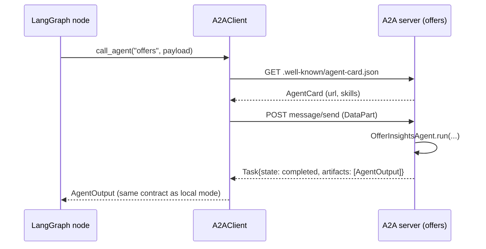

# 14 — A2A: agents as services

**Goal:** expose each insight agent as an Agent2Agent (A2A) service with an Agent Card and JSON-RPC, and let the graph call them over the network without changing anything else.

**Time:** 45 minutes.

## Concepts

- **A2A vs MCP.** MCP connects an agent to tools and data. A2A connects agents to other agents. With A2A, the Rejection agent can scale on its own, another team can replace the Offers agent, and other orchestrators can call these agents.
- **What is implemented** (a spec-shaped subset in its own file, `a2a.py`):
  - an Agent Card at `/.well-known/agent-card.json`;
  - JSON-RPC 2.0 `message/send` with a `DataPart` input;
  - a `Task` reply whose artifact is the `AgentOutput` contract;
  - `tasks/get`.
  
  Not implemented: streaming, push notifications, auth.
- **Same contract over the wire.** `call_agent()` returns an `AgentOutput`, so the graph doesn't care where the agent ran.

## Step 14.1 — Server and client

**File:** `hiring_intel/a2a.py`
```python
"""A2A (Agent2Agent) layer: every insight agent can run as an independent A2A service.

Why: in the default (local) mode the orchestrator calls agents in-process. With transport="a2a" the
orchestrator discovers agents through their Agent Cards and sends them tasks over JSON-RPC, so an agent
can be deployed, scaled or replaced (even by another team's agent in another language) without
changing the graph.

What this module implements (a minimal, spec-shaped subset of A2A):
  * Agent Card      GET  /.well-known/agent-card.json   (name, description, url, skills, modes)
  * message/send    POST /   JSON-RPC 2.0. params.message.parts carries a DataPart with the task input.
                    The result is a Task whose artifact holds a DataPart = AgentOutput (our contract).
  * tasks/get       POST /   returns a stored task by id
  * Task states     submitted -> working -> completed | failed

Serve all agents:   uvicorn hiring_intel.a2a:server --port 8100
  each agent lives at http://host:8100/agents/<name>/ with its own card.
Use from the graph: run(..., transport="a2a") with A2A_BASE_URL=http://host:8100

See docs/A2A.md for message examples and how this maps to the official a2a-sdk.
"""
from __future__ import annotations

import os
import uuid
from typing import Any, Literal

from fastapi import FastAPI, Request
from pydantic import BaseModel, Field

from hiring_intel.contracts import AgentOutput

PROTOCOL_VERSION = "0.3.0"


# ------------------------------------------------------------------ A2A data model (subset)
class AgentSkill(BaseModel):
    id: str
    name: str
    description: str
    tags: list[str] = []
    examples: list[str] = []
    inputModes: list[str] = ["application/json"]
    outputModes: list[str] = ["application/json"]


class AgentCapabilities(BaseModel):
    streaming: bool = False
    pushNotifications: bool = False
    stateTransitionHistory: bool = False


class AgentCard(BaseModel):
    protocolVersion: str = PROTOCOL_VERSION
    name: str
    description: str
    url: str
    version: str = "1.0.0"
    preferredTransport: str = "JSONRPC"
    capabilities: AgentCapabilities = AgentCapabilities()
    defaultInputModes: list[str] = ["application/json"]
    defaultOutputModes: list[str] = ["application/json"]
    skills: list[AgentSkill]


class Part(BaseModel):
    kind: Literal["text", "data"]
    text: str | None = None
    data: dict[str, Any] | None = None


class Message(BaseModel):
    role: Literal["user", "agent"]
    parts: list[Part]
    messageId: str = Field(default_factory=lambda: uuid.uuid4().hex)
    contextId: str | None = None
    kind: Literal["message"] = "message"


class TaskStatus(BaseModel):
    state: Literal["submitted", "working", "completed", "failed", "input-required", "canceled"]
    message: Message | None = None


class Artifact(BaseModel):
    artifactId: str = Field(default_factory=lambda: uuid.uuid4().hex)
    name: str
    parts: list[Part]


class Task(BaseModel):
    id: str = Field(default_factory=lambda: uuid.uuid4().hex)
    contextId: str
    status: TaskStatus
    artifacts: list[Artifact] = []
    kind: Literal["task"] = "task"


class JsonRpcRequest(BaseModel):
    jsonrpc: Literal["2.0"] = "2.0"
    id: str | int
    method: str
    params: dict[str, Any] = {}


# ------------------------------------------------------------------ skills per agent
SKILLS = {
    "sourcing": ("Sourcing Quality Agent", "Ranks sourcing channels per role and says which to cut or grow.",
                 ["sourcing", "channels", "hire-rate"]),
    "rejection": ("Rejection Pattern Agent", "Finds where and why candidates are rejected; JD vs interview vs source.",
                  ["rejection", "root-cause"]),
    "panel_load": ("Panel Load Balancer", "Finds overloaded / idle interviewers and proposes a rebalance plan.",
                   ["interviewers", "load"]),
    "offers": ("Offer Insights Agent", "Explains offer declines: compensation, timing or competing offers.",
               ["offers", "compensation"]),
    "pipeline": ("Pipeline Health Agent", "Finds SLA breaches and aging requisitions.", ["sla", "funnel"]),
}


def agent_card(name: str, base_url: str) -> AgentCard:
    title, desc, tags = SKILLS[name]
    return AgentCard(name=title, description=desc, url=f"{base_url.rstrip('/')}/agents/{name}/",
                     skills=[AgentSkill(id=f"{name}.analyze", name=title, description=desc, tags=tags,
                                        examples=['{"data_path": "data/raw/baseline_small", "run_id": "r1"}'])])


# ------------------------------------------------------------------ server
def build_agent_app(name: str) -> FastAPI:
    app = FastAPI(title=f"A2A {name}")
    tasks: dict[str, Task] = {}

    @app.get("/.well-known/agent-card.json")
    def card(request: Request):
        base = os.getenv("A2A_PUBLIC_URL", str(request.base_url).split("/agents/")[0])
        return agent_card(name, base).model_dump()

    @app.post("/")
    def rpc(req: JsonRpcRequest):
        if req.method == "tasks/get":
            t = tasks.get(req.params.get("id", ""))
            if not t:
                return {"jsonrpc": "2.0", "id": req.id, "error": {"code": -32001, "message": "Task not found"}}
            return {"jsonrpc": "2.0", "id": req.id, "result": t.model_dump()}
        if req.method != "message/send":
            return {"jsonrpc": "2.0", "id": req.id, "error": {"code": -32601, "message": "Method not found"}}
        msg = Message.model_validate(req.params["message"])
        payload = next((p.data for p in msg.parts if p.kind == "data"), None)
        task = Task(contextId=msg.contextId or uuid.uuid4().hex, status=TaskStatus(state="working"))
        tasks[task.id] = task
        if payload is None:
            task.status = TaskStatus(state="failed", message=Message(role="agent", parts=[
                Part(kind="text", text="expected a data part with data_path and run_id")]))
            return {"jsonrpc": "2.0", "id": req.id, "result": task.model_dump()}
        from hiring_intel.agents.insight_agents import AGENTS
        from hiring_intel.ingest import load_all
        out = AGENTS[name].run(load_all(payload["data_path"]), payload["run_id"],
                               force_tier=payload.get("force_tier"), compress=payload.get("compress", False),
                               use_cache=payload.get("use_cache", False), last_eval=payload.get("last_eval"))
        task.artifacts = [Artifact(name="agent_output", parts=[Part(kind="data", data=out.model_dump())])]
        task.status = TaskStatus(state="completed" if out.status != "failed" else "failed")
        return {"jsonrpc": "2.0", "id": req.id, "result": task.model_dump()}

    return app


def build_server() -> FastAPI:
    root = FastAPI(title="Hiring Intelligence A2A agents")
    for name in SKILLS:
        root.mount(f"/agents/{name}", build_agent_app(name))

    @root.get("/agents")
    def directory(request: Request):
        base = os.getenv("A2A_PUBLIC_URL", str(request.base_url))
        return [agent_card(n, base).model_dump() for n in SKILLS]

    @root.get("/health")
    def health():
        return {"ok": True}

    return root


server = build_server()


# ------------------------------------------------------------------ client
class A2AClient:
    def __init__(self, card_url: str, http=None):
        import httpx
        self.http = http or httpx.Client(timeout=120)
        self.card = AgentCard.model_validate(self.http.get(card_url).json())

    def send(self, data: dict, context_id: str | None = None) -> Task:
        msg = Message(role="user", parts=[Part(kind="data", data=data)], contextId=context_id)
        req = JsonRpcRequest(id=uuid.uuid4().hex, method="message/send", params={"message": msg.model_dump()})
        r = self.http.post(self.card.url, json=req.model_dump())
        r.raise_for_status()
        body = r.json()
        if "error" in body:
            raise RuntimeError(body["error"])
        return Task.model_validate(body["result"])


_clients: dict[str, A2AClient] = {}


def call_agent(name: str, data: dict, http=None) -> AgentOutput:
    """Discover the agent by its card, send the task, unwrap the AgentOutput artifact."""
    base = os.getenv("A2A_BASE_URL", "http://localhost:8100")
    if name not in _clients or http is not None:
        _clients[name] = A2AClient(f"{base}/agents/{name}/.well-known/agent-card.json", http=http)
    task = _clients[name].send(data, context_id=data.get("run_id"))
    try:
        return AgentOutput.model_validate(task.artifacts[0].parts[0].data)
    except Exception:
        return AgentOutput(agent=name, run_id=data.get("run_id", ""), status="failed",
                           error=f"A2A task {task.id} ended in state {task.status.state}")
```

## Step 14.2 — Protocol notes

**File:** `docs/A2A.md`
````markdown
# A2A (Agent2Agent) in this system

Code: [`hiring_intel/a2a.py`](../hiring_intel/a2a.py), kept in its own module on purpose. The graph uses it only when `transport="a2a"`.

## Why A2A here

In-process agents are simplest, but they tie every agent to one Python process and one deploy. A2A lets each insight agent run as an independent service that **describes itself** (Agent Card) and **accepts tasks** over a standard protocol. Then you can:

- scale the slow agent (Rejection) separately from the cheap ones;
- let another team replace an agent (say, a Java Offer agent backed by the comp system) without touching the graph;
- call the same agents from other orchestrators or tools.

MCP and A2A solve different problems: **MCP connects an agent to tools and data** (an ATS API, the vector DB); **A2A connects agents to other agents**. The stretch goal "MCP-style tool integration" would wrap `MockATSClient` and `retrieve()` as MCP tools; A2A wraps whole agents.

## What is implemented (a spec-shaped subset)

| A2A concept | Here |
| --- | --- |
| Agent Card | `GET /agents/<name>/.well-known/agent-card.json`: name, description, url, version, capabilities, skills, input/output modes |
| Agent directory | `GET /agents`: all five cards (convenience, not part of the spec) |
| Transport | JSON-RPC 2.0 over HTTP `POST /agents/<name>/` |
| `message/send` | Input = a `DataPart` with `{data_path, run_id, force_tier, compress, use_cache, last_eval}` |
| Task | Returned synchronously with `status.state` = `completed` or `failed` |
| Artifact | One `DataPart` holding the `AgentOutput` contract |
| `tasks/get` | Fetch a stored task by id |
| Not implemented | streaming (`message/stream`), push notifications, auth schemes, `input-required` multi-turn |

## Run it

```bash
uvicorn hiring_intel.a2a:server --port 8100
curl -s localhost:8100/agents/offers/.well-known/agent-card.json | jq .
A2A_BASE_URL=http://localhost:8100 python scripts/run_pipeline.py --transport a2a
```

In Docker Compose the `a2a` service runs this server and the app reaches it at `http://a2a:8100`.

## Message examples

Request:

```json
{"jsonrpc": "2.0", "id": "1", "method": "message/send",
 "params": {"message": {"role": "user", "kind": "message", "messageId": "m-1", "contextId": "run-42",
   "parts": [{"kind": "data", "data": {"data_path": "data/raw/baseline_medium", "run_id": "run-42"}}]}}}
```

Response (trimmed):

```json
{"jsonrpc": "2.0", "id": "1",
 "result": {"kind": "task", "id": "7f3c...", "contextId": "run-42", "status": {"state": "completed"},
   "artifacts": [{"name": "agent_output", "parts": [{"kind": "data",
     "data": {"agent": "offers", "status": "ok", "insights": [...], "cost_of_insight": {...}}}]}]}}
```

## Sequence



## Moving to the official SDK

The models mirror the A2A spec field names (`protocolVersion`, `skills`, `parts[].kind`, `Task.status.state`), so switching to the official `a2a-sdk` package is mostly mechanical: replace `build_agent_app` with an `AgentExecutor` that calls `AGENTS[name].run(...)` and emits the output as a data artifact, and replace `A2AClient` with the SDK client. Check the SDK version you install; its APIs have changed between releases.

## Security notes before exposing it

- Add an auth scheme to the card and enforce it (API key or OAuth); today the server trusts anyone who can reach it.
- `data_path` is a server-side path: validate it against an allow-list before production.
- Keep the A2A port on the internal Docker network unless another system really needs it.
````

## Verify

<!-- verify:14 -->
```bash
uvicorn hiring_intel.a2a:server --port 8100 --log-level warning > /tmp/a2a.log 2>&1 &
A2A_PID=$!
sleep 5
curl -s localhost:8100/agents/offers/.well-known/agent-card.json | python -c "import json,sys; c=json.load(sys.stdin); print(c['name'], '|', c['url'], '|', c['skills'][0]['id'])"
A2A_BASE_URL=http://localhost:8100 python - <<'EOF'
from hiring_intel.graph import run
s = run("data/raw/sourcing_shift_small", variant="ch14-a2a", transport="a2a")
print({a: (o["status"], len(o["insights"])) for a, o in s["outputs"].items()}, "errors:", s["errors"])
EOF
kill $A2A_PID
```

Expected output (captured on a fresh extract, mock backend):

```text
Offer Insights Agent | http://localhost:8100/agents/offers/ | offers.analyze
{'offers': ('ok', 1), 'panel_load': ('ok', 1), 'pipeline': ('ok', 3), 'rejection': ('ok', 1), 'sourcing': ('ok', 2)} errors: []
```

## Checkpoint

- [ ] each agent serves its own card
- [ ] a full run over A2A returns the same contract as a local run
