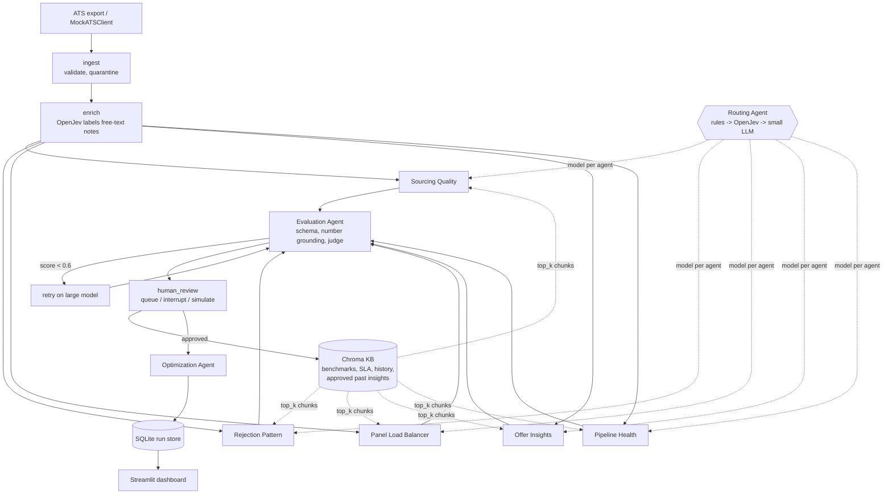

# 21 — The documentation package

**Goal:** the documents the capstone asks for: architecture, contracts, evaluation notes, optimization before/after, reflection and setup.

**Time:** 1–2 hours (rewrite the reflection in your own words).

| Required by the brief | File |
| --- | --- |
| Architecture diagram | `docs/ARCHITECTURE.md` (Mermaid; renders on GitHub) |
| Agent contract reference | `docs/CONTRACTS.md` |
| Evaluation notes | `docs/EVALUATION.md`, `docs/EXTERNAL_EVALUATION.md` |
| Optimization before/after | `docs/OPTIMIZATION_REPORT.md` |
| Decision reflection | `docs/REFLECTION.md` |
| Setup instructions | `README.md`, `docs/DEPLOYMENT.md` (chapter 20) |
| Also | `docs/HUMAN_IN_THE_LOOP.md`, `docs/OPENJEV.md`, `docs/DEMO_SCRIPT.md` |

The numbers in these docs come from the mock-mode benchmark. After running with real models, replace them from `data/eval/benchmark.csv`, the golden CSVs and your LangSmith experiments.

## Step 21.1 — README

**File:** `README.md`
````markdown
# Hiring Intelligence System

A multi-agent system that turns ATS hiring data into insights an Engineering Manager can act on. Every insight carries its **recommendation, evidence, confidence, cost and a cheaper alternative**, is checked by an **Evaluation Agent**, and is held for **human review** when it is high-stakes.

Built for *Capstone 2: AI-Powered Hiring Intelligence System*.

| | |
| --- | --- |
| Orchestration | LangGraph: parallel fan-out, retry loop, HITL interrupt/resume |
| Agents | 5 insight agents + Routing, Evaluation and Optimization agents |
| Simple decisions | **OpenJev** (open NLI cross-encoder, $0 API): note labelling, routing tie-breaks, HITL sensitivity, actionability pre-check |
| Agent interop | **A2A** (Agent Cards + JSON-RPC `message/send`) in [`hiring_intel/a2a.py`](hiring_intel/a2a.py) |
| RAG | Chroma + MiniLM (offline fallback: hashing embeddings), per-agent metadata filters |
| LLMs | LiteLLM (OpenAI / Anthropic / Ollama) or an offline **mock** backend |
| External validation | **LangSmith** (traces, hosted golden dataset, experiments) and **DeepEval** + Confident AI hub (regression suite; OpenJev as a $0 judge) — [docs/EXTERNAL_EVALUATION.md](docs/EXTERNAL_EVALUATION.md) |
| UI | Streamlit: overview, insights, human review, evaluation, cost & latency, compare inputs |
| Deploy | Docker Compose on a Linux box ([docs/DEPLOYMENT.md](docs/DEPLOYMENT.md)) |

## Quick start (offline, no API key, about 3 minutes)

```bash
python -m venv .venv && source .venv/bin/activate
pip install -r requirements.txt
python scripts/generate_mock_data.py --all        # 16 datasets, up to ~84k candidates
python scripts/write_knowledge_base.py && python scripts/make_golden_set.py
python scripts/benchmark.py                        # 80 runs: inputs x optimization variants
streamlit run app/dashboard.py                     # http://localhost:8501
```

Real models: copy `.env.example` to `.env`, set `LLM_BACKEND=litellm` and an API key. Real OpenJev: `pip install -r requirements-ml.txt` (or run the `openjev` Docker service).

## What runs where

```text
ingest -> enrich (OpenJev labels free-text notes)
       -> [sourcing | rejection | panel_load | offers | pipeline]   (parallel, each: features -> RAG -> route -> LLM -> validate)
       -> evaluate (schema, number grounding, judge) -> retry < 0.6 on large model
       -> human_review (queue | interrupt | simulate) -> optimize -> persist -> dashboard
```

## Repository map

| Path | What |
| --- | --- |
| `hiring_intel/contracts.py` | Shared output contract (Insight, AgentOutput, Decision, ReviewItem) |
| `hiring_intel/llm.py` | LLM door: LiteLLM or mock, JSON repair, cost, latency, cache |
| `hiring_intel/openjev.py` | OpenJev decider (local / HTTP / fallback) |
| `hiring_intel/enrich.py` | Note classification (OpenJev vs LLM) |
| `hiring_intel/metrics.py` | Deterministic pandas features per agent |
| `hiring_intel/agents/` | Insight agents, router, evaluator, optimizer |
| `hiring_intel/hitl.py` | Human-in-the-loop policy, queue, decisions, RAG write-back |
| `hiring_intel/a2a.py` | A2A server + client (separate file, as required) |
| `hiring_intel/graph.py` | LangGraph orchestrator |
| `hiring_intel/report.py` | Cost and latency accounting |
| `app/dashboard.py` | Streamlit UI |
| `services/openjev_server.py` | OpenJev as an HTTP service |
| `hiring_intel/evals/` | LangSmith experiment, DeepEval suite, OpenJev as DeepEval judge |
| `tests_eval/` | DeepEval regression suite (`deepeval test run`) |
| `scripts/` | data generator, benchmark, golden eval, LangSmith eval, CLI run |
| `docs/` | everything below |

## Docs

- [Architecture](docs/ARCHITECTURE.md) · [Output contract](docs/CONTRACTS.md)
- [Cost & latency definitions](docs/COST_AND_LATENCY.md) · [Optimization report](docs/OPTIMIZATION_REPORT.md)
- [Evaluation](docs/EVALUATION.md) · [External evaluation: LangSmith, DeepEval](docs/EXTERNAL_EVALUATION.md) · [Human in the loop](docs/HUMAN_IN_THE_LOOP.md)
- [OpenJev](docs/OPENJEV.md) · [A2A](docs/A2A.md)
- [Deployment (Docker on Linux)](docs/DEPLOYMENT.md)
- [Learning path](docs/LEARNING_PATH.md) · [Improvement points](docs/IMPROVEMENTS.md)
- [Reflection](docs/REFLECTION.md) · [Demo script](docs/DEMO_SCRIPT.md)

## Honest limits of the numbers in this repo

The committed benchmark ran with `LLM_BACKEND=mock`, `EMBEDDINGS=hashing` and the OpenJev **keyword fallback**, because the build machine had no API key and no Hugging Face access. Token counts are estimated (chars/4) and LLM latency is **simulated** from `config/models.yaml`. Cost *ratios* between variants are meaningful; absolute quality and latency must be re-measured with real models (`LLM_BACKEND=litellm`, real OpenJev) before you quote them.
````

## Step 21.2 — Architecture and contracts

**File:** `docs/ARCHITECTURE.md`
````markdown
# Architecture

## One-line summary

Pandas computes the numbers, OpenJev makes closed-set decisions, the LLM interprets and recommends, a second agent checks the first, and a human signs off anything that changes pay, headcount or someone's workload.

## Graph



With `transport="a2a"` the five insight agents run behind the A2A server instead of in-process; nothing else in the graph changes.

## Components

| Component | File | Job | Model |
| --- | --- | --- | --- |
| Ingest | `ingest.py` | Load 6 CSVs, parse dates, drop duplicates, referential integrity, quarantine count | none |
| Enrich | `enrich.py` | Fill missing rejection/decline reasons from free-text notes | OpenJev |
| Sourcing Quality | `agents/insight_agents.py` | Channels to grow or cut, per role | routed |
| Rejection Pattern | same | Where/why rejections happen; JD vs sourcing vs interview calibration | routed (usually large) |
| Panel Load Balancer | same | Overloaded/idle interviewers + concrete move plan | routed (usually small) |
| Offer Insights | same | Why offers decline (comp, timing, competing) | routed (usually large) |
| Pipeline Health | same | SLA breaches, aging requisitions, funnel | routed (usually small) |
| Routing Agent | `agents/router.py` | Pick small vs large per agent | rules, OpenJev, small LLM |
| Evaluation Agent | `agents/evaluator.py` | Quality gate | deterministic + judge |
| Optimization Agent | `agents/optimizer.py` | Cheaper/faster suggestions from run stats | small LLM |
| HITL | `hitl.py` | Review policy, queue, decisions, RAG write-back | OpenJev for sensitivity |
| A2A | `a2a.py` | Expose agents as A2A services; client used by the graph | none |

## State and checkpointing

The graph state holds only JSON-able values: the run config (incl. `data_path`), agent outputs as dicts, eval results, review items. DataFrames stay in a per-path cache in `ingest.py`. That keeps checkpoints small and makes `interrupt()`/`resume()` work for human review.

## Error handling per hop

| Hop | Failure | Handling |
| --- | --- | --- |
| Ingest | missing table/column | hard fail with a clear message |
| Ingest | bad rows, orphan events | dropped and counted as quarantined |
| Enrich | low-confidence label | stored as `unclassified`, never forced |
| Retrieval | empty or Chroma error | agent continues, status `degraded`, confidence capped |
| Routing | OpenJev unsure | escalates to a small-LLM decision |
| LLM call | timeout / 429 / 5xx | LiteLLM `num_retries=2`, then agent `failed` |
| LLM JSON | schema violation | one repair turn with the validation error |
| Agent | any exception | caught in `BaseInsightAgent.run`, recorded in `errors` |
| Evaluate | score < 0.6 or failed agent | one retry on the large model |
| Judge | judge call fails | deterministic checks still score it (judge = null) |
| A2A | remote task fails | `failed` AgentOutput with the task id and state |
| UI | failed agent | red card with the error, never hidden |

Two demo switches prove this: `crash_agent="offers"` (agent raises, run recovers on retry) and `inject_fault="sourcing"` (fabricated numbers, evaluator catches them, retry on large).

## Names and privacy

The generated CSVs carry `candidate_name`, `interviewer_name` and `hiring_manager` so demos are easy to follow (dashboard → **Candidates** tab). IDs remain the only join keys: names repeat (about 1,030 unique names for 1,179 candidates on the small input) and can change.

Names never leave the dashboard. Every feature table becomes prompt text through `metrics.to_text`, which drops `PII_COLUMNS`, and panel features strip interviewer names at the source. `tests/test_privacy.py` captures every prompt in a full run and fails if any candidate, interviewer or hiring-manager name appears. That keeps names out of LLM calls, LangSmith traces and DeepEval/Confident AI uploads, and out of the model's reasoning, where they could bias hiring recommendations.

## Why these choices

- **LangGraph, not n8n:** parallel fan-out + conditional retry + `interrupt()` for HITL, all testable in pytest.
- **Pandas-first features:** the LLM never counts rows; every evidence number can be checked mechanically.
- **OpenJev for closed-set decisions:** labelling thousands of notes or answering yes/no needs no generation; it costs $0 API and is deterministic.
- **Rules-first routing:** a model choosing a model on every call would eat the savings it creates.
- **A2A in its own module:** agents can be deployed and scaled separately or swapped for another team's agent; the graph only knows names and cards.
````

**File:** `docs/CONTRACTS.md`
````markdown
# Output contract

Defined in [`hiring_intel/contracts.py`](../hiring_intel/contracts.py). One shape for every agent, so evaluation, HITL, cost tracking, A2A and the dashboard all consume the same thing.

## Required fields (from the brief)

| Field | Type | Filled by | Notes |
| --- | --- | --- | --- |
| `recommendation` | str (≥ 30 chars) | LLM | Must name who / what / when or a target; generic phrases are rejected |
| `evidence` | list[Evidence] (≥ 1) | LLM | `metric`, `value`, `segment`, `source` = data or rag, `ref` = chunk id for rag |
| `confidence_score` | float 0–1 | LLM, then capped by code | cap = min(0.95, 0.5 + 0.1 × evidence items + 0.1 if any rag evidence) |
| `cost_of_insight` | Cost | **code**, never the LLM | model, tier, tokens, USD, latency, simulated?, cached? |
| `alternative` | Alternative | LLM | cheaper/faster option, its trade-off, est. USD |

Extras: `title`, `severity` (low/medium/high), `rebalance_plan` (Panel Load only: list of moves).

## AgentOutput

`agent`, `run_id`, `status` (ok / degraded / failed), `insights[]`, `cost_of_insight`, `compute_ms`, `retrieved_chunks[]`, `error`.

## Other contracts

- `Decision`: an OpenJev decision: task, choice, confidence, per-option probabilities, backend, latency, escalated.
- `ReviewItem`: a HITL queue entry: insight, reasons, status (pending / approved / edited / rejected / auto_published), reviewer, note.
- `EvalResult` (`agents/evaluator.py`): schema_ok, numbers_grounded, refs_valid, judge scores, overall, flags.

## Real example (Offer Insights, comp_crunch input, medium)

```json
{
  "agent": "offers", "status": "ok", "compute_ms": 241,
  "retrieved_chunks": ["offer_timing", "comp_bands"],
  "cost_of_insight": {"model": "gpt-4o", "tier": "large", "input_tokens": 1069, "output_tokens": 300,
                      "usd": 0.005673, "latency_ms": 7240, "simulated": true, "cached": false},
  "insights": [{
    "title": "Offers below 90% of expected CTC are being declined",
    "recommendation": "Comp partner and hiring managers: set an offer floor of 90% of the candidate's expected CTC, with exceptions approved within 48 hours. Offers under that line decline at 72% vs 18% in the 0.9-1.0 band.",
    "evidence": [
      {"metric": "decline_rate", "value": 0.721, "segment": {"ratio_band": "<0.9"}, "source": "data"},
      {"metric": "decline_rate", "value": 0.176, "segment": {"ratio_band": "0.9-1.0"}, "source": "data"},
      {"metric": "offers", "value": 197, "segment": {"ratio_band": "<0.9"}, "source": "data"},
      {"metric": "share_of_declines", "value": 0.861, "segment": {"reason": "compensation"}, "source": "data"},
      {"metric": "benchmark", "value": "Offer timing: candidates who wait more than 7 days ...", "source": "rag", "ref": "offer_timing"}
    ],
    "confidence_score": 0.95, "severity": "high",
    "alternative": {"option": "Small model + rules",
                    "trade_off": "Band math is deterministic; a small model can phrase it. Large model adds value only when causes compete."}
  }]
}
```

Its evaluation: `numbers_grounded 1.0`, `refs_valid true`, judge 4/5/1, overall 0.97. HITL: pending (severity high, OpenJev: changes compensation).
````

## Step 21.3 — Evaluation

**File:** `docs/EVALUATION.md`
```markdown
# Evaluation

## Layers

1. **Schema** (free): Pydantic rejects confidence outside 0–1, empty evidence, recommendations under 30 characters or with generic phrases ("consider improving", "monitor closely").
2. **Deterministic grounding** (free): every numeric evidence value must appear in the features the agent was given (0.721 or 72.1% both match); every `rag` evidence `ref` must be a chunk that was actually retrieved.
3. **Judge**: rubric of actionability, grounding, hallucination risk (1–5). Real mode: an LLM judge (`config/models.yaml → judge`). Mock mode: a heuristic judge + OpenJev "is this actionable?", labelled `heuristic+openjev` in results.

`overall = 0.35 × grounded + 0.15 × refs_valid + 0.5 × judge`, **capped at 0.55 when any number is ungrounded**. Below 0.6 → one retry on the large model.

## Golden set

`data/golden/golden_set.jsonl`: 18 scenarios over 5 input types. Each names an agent and an expectation (title must mention X, minimum or maximum severity, forbidden titles). It includes a **healthy control** where nothing should be raised above low, and trap expectations (no `[jd]` root cause when the problem is sourcing).

| Input type | What it plants | Cases |
| --- | --- | --- |
| baseline | referral > job board (Backend), agency fails Data tech_1, Mobile JD mismatch, 2 overloaded interviewers, comp declines, SRE onsite SLA + aging reqs | 6 |
| healthy | nothing | 5 |
| comp_crunch | most offers below 90% of expected CTC | 2 |
| interviewer_burnout | 3 people carry most interviews; slow tech stages | 2 |
| sourcing_shift | half of applicants from agencies that fail tech_1 everywhere | 3 |

Run: `python scripts/run_eval.py --size medium --variant optimized`.

## Results (mock backend)

| Size | all_large | optimized |
| --- | --- | --- |
| small (~1.2k candidates) | 15/18 (83%) | 15/18 (83%) |
| medium (~6k) | 18/18 | 18/18 |
| large (~25k) | 18/18 | 18/18 |

**Small-input failures are real false positives:** with about 50 applicants per role × channel, random noise produced a "Data: referral out-converts job board" finding and a "timing is the main decline reason" finding on the healthy control. The z-test threshold is not enough at this sample size. See [IMPROVEMENTS.md](IMPROVEMENTS.md).

**A regression the golden set caught:** compressing the Panel Load features (top and bottom 8 interviewers only) changed the median the agent compared against, so overload went undetected (medium: 15/18). Fixed by computing the panel median on all interviewers before trimming. A related truncation (only the top 8 rows kept, so "8 over policy" instead of 10) was found by comparing chapter outputs in the implementation guide; compressed tables now keep every over-policy row.

## Fault tests

| Test | Expected | Result |
| --- | --- | --- |
| `inject_fault="sourcing"` adds 3 invented numbers per insight | grounding < 0.8 → overall ≤ 0.55 → retry on large | caught, retried, 0.97 after retry |
| `crash_agent="offers"` | run continues, offers retried | recovered |
| HITL interrupt/resume | run pauses with pending items; resumes with decisions | passes (`tests/test_graph.py`) |

## External validation

LangSmith experiments and a DeepEval suite (with Confident AI upload) run the same golden set and per-insight metrics outside the agent that produced them. See [EXTERNAL_EVALUATION.md](EXTERNAL_EVALUATION.md). The DeepEval suite found that "no action" findings lacked an owner and a re-check date; fixed in the agents.

## Judge validation (do this with real models)

Hand-score 10 outputs on the same rubric and report agreement with the LLM judge ("within 1 point on 8/10"). Use a judge model at least as strong as the generator and ideally from a different family.

## Note-label accuracy

`enrich()` compares labels with the generator's hidden truth (`_labels.csv`) three ways: `accuracy_vs_truth` (escalated notes count as wrong), `accuracy_when_labelled` (only notes that got a label) and `escalated_share`. Keyword fallback: 0.92 / 1.00 / 0.08, with ambiguous notes left `unclassified`. Real OpenJev on CPU: 0.385 with question-style hypotheses and a 0.55 floor, 1.00 on clear notes with plain-statement hypotheses ([OPENJEV.md](OPENJEV.md)).
```

**File:** `docs/EXTERNAL_EVALUATION.md`
````markdown
# External evaluation: LangSmith and DeepEval (Confident AI)

The in-repo Evaluation Agent grades every run as the pipeline runs. External tools add three things it cannot: **traces** you can open call by call, **experiments** you can compare across prompt and model versions, and **independent metrics** written by someone other than you, so the system is not only grading itself.

| Tool | What it does here | Files |
| --- | --- | --- |
| LangSmith | Tracing of every graph node and LLM call (model, tokens, USD, latency on each span); the golden set as a hosted dataset; one experiment per variant × size | `hiring_intel/evals/langsmith_eval.py`, `scripts/langsmith_eval.py`, `llm.py` (`@traceable`) |
| DeepEval | Pytest-style regression suite over real pipeline output: grounded numbers, actionability, faithfulness, hallucination, G-Eval rubric | `hiring_intel/evals/deepeval_suite.py`, `tests_eval/test_deepeval.py` |
| Confident AI | DeepEval's hosted hub: stores each test run, compares runs, tracks regressions | `deepeval login`, then `deepeval test run` |
| OpenJev in DeepEval | DeepEval's `system_one` eval mode judged by OpenJev: faithfulness and hallucination with no LLM | `hiring_intel/evals/openjev_deepeval.py` |
| GitHub Actions | Offline checks on every push; real-model experiments nightly | `.github/workflows/eval.yml` |

## 1. LangSmith

### Set up

1. Create an account at smith.langchain.com and an API key (Settings → API Keys).
2. In `.env`: `LANGSMITH_TRACING=true`, `LANGSMITH_API_KEY=...`, `LANGSMITH_PROJECT=hiring-intel` (EU accounts also set `LANGSMITH_ENDPOINT=https://eu.api.smith.langchain.com`).
3. Run anything (`python scripts/run_pipeline.py`). Open the project: each run is a trace with the LangGraph nodes as children and every `call_structured` span tagged with agent, tier, tokens, USD and latency.

### Golden set as an experiment

```bash
python scripts/langsmith_eval.py --variant all_large --size medium
python scripts/langsmith_eval.py --variant optimized --size medium
```

The first call uploads `data/golden/golden_set.jsonl` as dataset `hiring-intel-golden`. Each call records an experiment (`optimized-medium-…`). In the dataset's **Experiments** tab, select both and **Compare**: per case you see the pass/fail, grounding, eval score, cost and latency side by side. That is your before/after for the optimization report, with the evidence one click away.

| Evaluator | Score |
| --- | --- |
| `golden_pass` | 1 if the case's expectation holds (title, severity, forbidden titles) |
| `numbers_grounded` | share of evidence numbers found in the agent's features |
| `eval_agent_overall` | the in-repo Evaluation Agent's score, so you can see if it agrees with the golden check |
| `run_cost_usd`, `run_e2e_seconds` | cost and latency of the run that produced the case |
| `golden_pass_rate` (summary) | share of cases passed in the experiment |

### Offline

`python scripts/langsmith_eval.py --offline` runs the same target and evaluators locally with no LangSmith client: nothing is uploaded. CI uses it as a gate (must stay 18/18 on medium inputs).

Results in this build (mock backend): medium 18/18, small 15/18, matching `scripts/run_eval.py`.

## 2. DeepEval and Confident AI

### Metrics

| Metric | Judge | What it catches |
| --- | --- | --- |
| Grounded numbers (custom) | none | evidence numbers not present in the feature table |
| Actionable (rule, custom) | none | recommendations with no owner, time frame or number |
| Faithfulness | OpenJev (`system_one`) or LLM | claims not supported by what the agent was given (features + RAG chunks) |
| Hallucination | OpenJev (`system_one`) or LLM | statements contradicting the feature table |
| G-Eval "Actionability" | LLM | a rubric judgement: owner, action, time frame, follows from evidence |

### Run

```bash
pytest tests_eval/ -q                                   # offline: custom metrics only
DEEPEVAL_JUDGE=openjev OPENJEV_URL=http://localhost:8200 pytest tests_eval/ -q
DEEPEVAL_JUDGE=llm OPENAI_API_KEY=... deepeval test run tests_eval/test_deepeval.py
```

Local LLM judge instead of OpenAI: `deepeval set-ollama --model llama3.1`.
Choose inputs with `DEEPEVAL_INPUTS=baseline_large,comp_crunch_large`.

### Confident AI hub

```bash
deepeval login --api-key <your Confident AI key>     # once
deepeval test run tests_eval/test_deepeval.py         # results upload as a test run
```

On the hub, open **Test Runs** to see each insight's metric scores and reasons, compare against the previous run, and spot regressions after a prompt or model change.

### What it found in this build

The offline suite failed 2 of 20 cases on the first run: on the healthy input, the "no action needed" findings named no owner and no follow-up date. The fix was in the agents (every no-action finding now starts "Recruiting ops lead:" and gives a re-check date), not in the metric. After the fix: 20/20.

### OpenJev as DeepEval's judge

DeepEval 4.x metrics accept `eval_mode="system_one"` with a `system_one_model` that answers yes/no, choice and score questions with probabilities. `OpenJevSystemOne` implements that interface, so faithfulness and hallucination can run on OpenJev alone: local, deterministic, $0 API. It needs the real model; with the keyword fallback the suite refuses to run this mode rather than produce meaningless scores. Validate it once against the LLM judge on 20 insights before you trust it.

## 3. Which to use when

| Question | Use |
| --- | --- |
| Why did this run produce that insight? | LangSmith trace |
| Did my prompt change make things better or worse? | LangSmith experiment comparison |
| Did quality regress since yesterday? | DeepEval test run on Confident AI (nightly CI) |
| Is every number traceable to data? | In-repo evaluator + DeepEval grounded numbers |
| Can I judge cheaply at scale? | DeepEval `system_one` with OpenJev |

Alternatives with the same role: Langfuse (open-source tracing + evals; LiteLLM has a callback), Ragas (RAG-specific metrics), Arize Phoenix (tracing + evals, self-hosted).
````

## Step 21.4 — Optimization report

**File:** `docs/OPTIMIZATION_REPORT.md`
```markdown
# Optimization report: before / after

Generated from `data/eval/benchmark.csv` (80 runs: 5 scenarios × 3 sizes + one xlarge input, × 5 variants). Each variant adds one lever to the previous one. Mock backend: costs use example prices; latency is simulated (see [COST_AND_LATENCY.md](COST_AND_LATENCY.md)). Re-run `python scripts/benchmark.py` with `LLM_BACKEND=litellm` to replace these with real measurements.

## Headline: baseline scenario, large input (25k candidates, 14.7k notes to label)

| Variant | Lever added | Run cost (USD) | vs previous | E2E latency | Input tokens | Golden pass |
| --- | --- | --- | --- | --- | --- | --- |
| all_large | none: everything on the large model, LLM labels notes | 0.1682 | — | 175.5 s | 292,241 | 18/18 |
| routed | **A. model routing** | 0.1367 | −19% | 173.6 s | 292,170 | — |
| routed_compressed | **B. context compression** | 0.1279 | −6% | 173.1 s | 285,460 | 15/18 before fix, 18/18 after |
| optimized | **C. OpenJev for simple decisions** | 0.0162 | −87% | 17.1 s | 6,794 | 18/18 |
| optimized_cached | **D. response cache (re-run)** | 0.0003 | −98% | 3.8 s | 6,781 | 18/18 |

Overall: **$0.1682 → $0.0162 per run (−90%) and 176 s → 17 s E2E** with no golden-set regression on medium and large inputs.

**Two fixes changed the baseline (October 2026).** (1) The LLM note labeller used to return a bare list of labels matched by position and stored by note text. One skipped label shifted the rest of its batch, and because every copy of a note shared the last label written, the damage spread to the whole dataset. A real model scored 0.359 that way. Labels now carry the note number and are stored per row. Each answer is longer, so the baseline costs more: $0.1277 → $0.1682, and labelling 175 s instead of 102 s simulated. (2) Re-running the benchmark added costs onto the previous run with the same `run_id` (doubling them); `graph.run` now purges a fixed run id first.

**Privacy guard, a side effect on cost.** The datasets now carry candidate, interviewer and hiring-manager names for demos. `metrics.strip_pii` keeps them out of every prompt; before that, the uncompressed panel table sent interviewer names to the LLM. Removing them cut the all-large run on the large input from $0.1304 to $0.1277 with no change in golden results.

## How cost scales with input size (baseline scenario)

| Input | Candidates | all_large | routed | routed_compressed | optimized |
| --- | --- | --- | --- | --- | --- |
| small | 1.2k | $0.0508 | $0.0263 | $0.0214 | $0.0159 |
| medium | 6.3k | $0.0774 | $0.0521 | $0.0439 | $0.0161 |
| large | 25k | $0.1682 | $0.1367 | $0.1279 | $0.0162 |
| xlarge | 84k | $0.4456 | $0.3959 | $0.3859 | $0.0163 |

With an LLM labelling notes, cost grows linearly with the number of notes. With OpenJev the run cost is flat: agents see aggregated features whose size does not depend on candidate count.

## Per lever

**A. Routing (−19% on large input, −48% on small).** Panel Load, Pipeline Health and Sourcing go to the small model on rule scores; Rejection and Offers go large through an OpenJev tie-break ("does this need causal reasoning?"). Golden score unchanged on medium/large.

**B. Compression (−6% of run cost here; insight-agent input tokens −28% on small and −52% on large inputs: 7,878 → 5,697 and 12,746 → 6,074).** Run cost moves less because, in this variant, note labelling still dominates. Top-N rows, pruned columns, `top_k` 2. The golden set caught a regression: trimming the panel table to the top and bottom 8 interviewers distorted the median, so Panel Load stopped flagging overload (15/18). Fix: compute the panel median before trimming and pass it as a column. After the fix: 18/18. A second issue surfaced when the guide's chapter outputs were compared: keeping only the top 8 rows truncated the overloaded list ("8 over policy" where the full table showed 10). Compressed tables now keep every over-policy row.

**C. OpenJev (−87%).** Labelling 14.7k free-text notes moved from 295 batched small-LLM calls ($0.112) to local NLI decisions. It also removed ~150 s of simulated E2E latency. In this build OpenJev ran as the keyword fallback (no Hugging Face access); label accuracy vs planted truth was 0.92 with the 3 deliberately ambiguous note templates (about 8% of notes) left `unclassified` instead of guessed. The real model (`qwen3.5-0.8b-nli-v2s-long`) was then measured on a laptop CPU. With plain-statement hypotheses it labelled every clear note correctly (1.00, against 0.385 with the first question-style wording; see [OPENJEV.md](OPENJEV.md)). It took about **8.4 s per unique note**. The synthetic data has 25 note templates and labels are memoised, so the run here stays a few minutes. Real notes are mostly unique, and 14.7k notes would take ~34 h on that CPU against ~150 s for the batched small LLM. So lever C is a **cost** saving that becomes a **latency** loss on CPU. It is worth taking on a GPU, or for the low-volume yes/no decisions; for bulk note labelling on CPU, keep the small LLM.

**D. Cache (−98% on repeats).** Identical prompt + model returns the stored response. It helps re-runs on unchanged data and the demo; it does nothing on fresh data, so it is reported separately.

## What I would not do

- Downgrade Rejection/Offers to the small model just because the mock judge scores them 0.97: the mock judge cannot see reasoning quality. Decide with a real judge and human ratings.
- Cache across data refreshes: the key includes the features text, so this is safe, but a TTL is still wise.
```

## Step 21.5 — Human in the loop and OpenJev

**File:** `docs/HUMAN_IN_THE_LOOP.md`
```markdown
# Human in the loop

Code: [`hiring_intel/hitl.py`](../hiring_intel/hitl.py), graph node `human_review` in [`graph.py`](../hiring_intel/graph.py), UI tab **Human review**.

## Policy: when a human must look

Configured in `config/sla.yaml → hitl`. An insight goes to the review queue if **any** rule fires:

| Rule | Why |
| --- | --- |
| `confidence_score < 0.6` | The system itself is unsure |
| `severity == high` | High impact if wrong |
| Evaluator flags: `ungrounded_numbers`, `invalid_rag_ref`, `hallucination_risk` | Evidence did not check out |
| OpenJev says the recommendation changes **compensation, headcount, or a person's workload/role** | People decisions need an accountable owner |
| OpenJev unsure about sensitivity | Default to a human |

Everything else is `auto_published`.

## Three modes

| Mode | Behaviour | Use |
| --- | --- | --- |
| `queue` (default) | Run completes; flagged insights wait as `pending` | Dashboard workflow; reviewers come later |
| `interrupt` | LangGraph `interrupt()` pauses the run at `human_review`; `resume(run_id, decisions)` continues | CLI review, demos, approval-before-publish |
| `simulate` | Scripted reviewer approves unless evidence failed | Benchmarks only; recorded as `simulated-policy` |

Terminal review: `python scripts/run_pipeline.py --data data/raw/comp_crunch_small --hitl interrupt`.

## Decisions and what they do

| Action | Effect |
| --- | --- |
| Approve | Status `approved`; text indexed into Chroma as `past_insight`, so later runs can cite it |
| Edit | Status `edited`; your rewritten recommendation is stored and indexed |
| Reject | Status `rejected` with your note; never shown as an action; use these for prompt fixes |

Every decision keeps the reviewer name, note and the reasons it was flagged (`review_queue` table).

## What the benchmark showed

On the large baseline input 7 of 8 insights were sent for review: almost every real finding is either high-severity or touches workload/comp. That is safe but will cause review fatigue. See [IMPROVEMENTS.md](IMPROVEMENTS.md) for tuning ideas (a severity-only rule per agent, batching by owner, auto-approve repeats of approved insights).

## Learning from reviews

- **Approval rate per agent** tells you which agent's prompts need work.
- **Edits** are the best training data you will get: compare the original and edited recommendation to improve the prompt or rules.
- **Rejected with "evidence did not check out"** should match evaluator flags; if not, the evaluator is missing something.
```

**File:** `docs/OPENJEV.md`
````markdown
# OpenJev for simple decisions

Code: [`hiring_intel/openjev.py`](../hiring_intel/openjev.py), service: [`services/openjev_server.py`](../services/openjev_server.py).

## What it is

OpenJev ([huggingface.co/AlexWortega/openjev](https://huggingface.co/AlexWortega/openjev), MIT licence per its model card) is Qwen3.5 fine-tuned as an NLI **cross-encoder**. Given a premise and a hypothesis it returns P(contradiction), P(entailment), P(neutral). To decide between options you score one hypothesis per option and take the highest entailment. Write each hypothesis as a plain statement ("The candidate's system design was weak."), not as a question with an answer appended; the measurements below show why. It does not generate text, it is deterministic, and its option scores do not depend on option order.

Checkpoints that exist in the repo (checked October 2026): `qwen3.5-0.8b-nli-v2s-long` (CPU-friendly; the default here), `qwen3.5-4b-nli-v2` (reads text and images; use on a GPU), `qwen3.5-4b-nli` (v1, text only) and `qwen3.5-35b-a3b-nli` (35B mixture-of-experts). The model card also describes `…-nli-v5` checkpoints that are not in the repo; loading one fails with a misleading tokenizer error. `LocalOpenJev` now checks the subfolder first and lists the real ones. All of them use the labels contradiction / entailment / neutral and `nli_template = "Premise: {premise}\nHypothesis: {hypothesis}"`.

## Where this system uses it

| Decision | Premise | Options | Why not the LLM |
| --- | --- | --- | --- |
| Label rejection notes | interviewer's free-text note | 7 reasons | Thousands of items per run; closed label set |
| Label decline notes | recruiter's note | comp / competing / timing / location | Same |
| Routing tie-break | task profile text | yes / no "needs causal reasoning?" | Runs before every borderline agent; must be ~free |
| HITL sensitivity | the recommendation | yes / no "changes comp, headcount or workload?" | Gate on every insight |
| Actionability pre-check | the recommendation | yes / no "specific and actionable?" | Cheap signal for the evaluator |

Every decision is logged to the `decisions` table with its backend, confidence and whether it **escalated**. A decision escalates when its confidence is below the floor for its option count (`min_confidence` 0.55 for yes/no, `min_confidence_multi` 0.30 for 3+ options, because probability spreads across more options), or when it picks the **abstain** option. Note labelling adds an `unclear` option ("The note does not name any specific skill, problem or reason.") so a vague note can say so instead of being forced into a label. Note labels become `unclassified`, routing falls back to a small-LLM call, and HITL marks the item "sensitivity unclear" for a human.

## Backends

| Backend | When | Set up |
| --- | --- | --- |
| `http` | Docker Compose `openjev` service (recommended) | `docker compose --profile openjev up -d`, `OPENJEV_URL=http://openjev:8200` |
| `local` | Weights loaded in-process | `pip install -r requirements-ml.txt` |
| `fallback` | No weights available (offline CI, this build) | none; keyword scorer with the same interface |
| `auto` (default) | http if `OPENJEV_URL` set, else local, else fallback | — |

The committed benchmark used **fallback** because the build machine could not reach Hugging Face. The real model was then measured on a laptop CPU (below).

## Measured with the real model (`qwen3.5-0.8b-nli-v2s-long`, CPU, October 2026)

Rejection notes on `baseline_small`: 710 notes, 21 unique note texts, 18 of them with a clear reason. Accuracy is weighted by how often each note occurs.

| Setup | Accuracy on clear notes |
| --- | --- |
| question hypotheses (`"What is the main reason…? Answer: fundamentals"`), floor 0.55 | 0.41 (the first run reported 0.385 overall) |
| question hypotheses, no floor | 0.73 |
| **plain-statement hypotheses**, no floor | **1.00** |
| plain-statement hypotheses, floor 0.30 | **1.00** |
| plain-statement + `unclear` option, through `enrich()` on `baseline_large` (14.7k notes) | **1.00** when labelled; 17.7% escalated (8% are truly ambiguous) |

What this shows:

1. **Hypothesis wording mattered most.** Labels such as "culture add" or "JD mismatch" in a question template lost to near-synonyms; a one-sentence description of each label fixed every clear note.
2. **A yes/no floor kills multi-class decisions.** With 7 options, correct answers often scored 0.36–0.5. The 0.55 floor marked them `unclassified`, and accuracy counts that as wrong.
3. **Ambiguous notes are not escalated by a floor alone.** "Mixed signals across the loop" got `culture add` at 0.73. The raw entailment was 0.13 (the model did not believe it), but normalising across options hid that. The `unclear` abstain option fixes that: nothing is mislabelled now. It is too cautious, though. It escalates 17.7% of notes against 8% truly ambiguous ones, so some clear notes go to a human. The likely culprits are the notes whose raw entailment was lowest ("Applied for a different scope than the posting", "Expected Kotlin/Swift depth per job description", "Could not partition the service…"). Tune `UNCLEAR_HYPOTHESIS` and those label sentences on your own labelled notes.

**Latency:** about 8.4 s per unique note on CPU with 7 hypotheses, 10.4 s with 8 (the `unclear` option adds one; scored in one batch through the HTTP service). The system memoises by note text, so the synthetic data (25 templates) labels in about 3–4 minutes at any size. Real notes are mostly unique: 14.7k notes would take about 34 hours on that CPU. For production, run the `openjev` service on a GPU, or keep note labelling on the small LLM and use OpenJev only for the low-volume yes/no gates (routing, HITL sensitivity, actionability), where 2–3 s per decision is acceptable.

## Loading the model directly

```python
from transformers import AutoModelForSequenceClassification, AutoTokenizer
sub = "qwen3.5-0.8b-nli-v2s-long"
tok = AutoTokenizer.from_pretrained("AlexWortega/openjev", subfolder=sub)
model = AutoModelForSequenceClassification.from_pretrained("AlexWortega/openjev", subfolder=sub)
text = model.config.nli_template.format(premise="...", hypothesis="...")
```

`LocalOpenJev` uses `config.nli_template` when present and finds the entailment index from `config.id2label` (model card order: contradiction, entailment, neutral).

## Caveats to put in your eval notes

- **Calibration:** probabilities are not calibrated for your labels. Tune `min_confidence_multi` and the hypothesis sentences on 50 hand-labelled notes; `enrich()` reports `accuracy_when_labelled` and `escalated_share` separately so you can see which way a change moved.
- **Prompt injection:** the model card reports that one adversarial line sharply lowers accuracy. Never use OpenJev alone as a safety gate; pair it with deterministic checks (the HITL policy also uses severity, confidence and eval flags).
- **Benchmark contamination:** the v5 checkpoints were trained on test splits of public benchmarks (per the card), so public benchmark scores are not evidence. Your own labelled notes are.
- **Licence:** the Hugging Face weights are MIT per the card. A separate Docker Hub image (`ai/openjev`) states CC BY-NC 4.0 for its source weights; check which artefact you deploy.
- **Cost model:** $0 API, but CPU/GPU time: about 8.4 s per 7-option note on a laptop CPU. `enrich()` reports `ms_per_unique_note`; multiply by your number of unique notes before choosing this lever.
````

## Step 21.6 — Reflection and demo

**File:** `docs/REFLECTION.md`
```markdown
# Reflection: design choices and why (one page)

*Draft for you to rewrite in your own words; the brief grades your reasoning, not mine.*

**Compute first, interpret second.** The biggest decision was to keep counting out of the LLM. Pandas produces every number; the model reads small feature tables and recommends. That one rule made grounding checkable (every evidence number can be found in the features), shrank prompts to a few thousand tokens regardless of input size, and made the rule-based "alternative" honest: it really is the same numbers without narrative.

**LangGraph over n8n.** I needed parallel fan-out, a conditional retry edge and a pause for human approval. LangGraph gives all three in code I can test with pytest. n8n would have been faster to wire but harder to version and test.

**Three tiers of decision-maker.** Rules decide what rules can (thresholds, routing scores). OpenJev decides closed-set questions (labels, yes/no) at $0 API cost. The LLM handles interpretation and wording. The benchmark showed note labelling was the largest cost driver; moving it to OpenJev cut run cost by 81% and made cost flat as input grows.

**A second AI checking the first, plus a human.** The Evaluation Agent catches invented numbers mechanically and retries on a larger model; the fault-injection test proves it. The HITL gate sends anything touching pay, headcount or workload to a person. Trust comes from those two together, not from a better prompt.

**What the golden set taught me.** It caught a compression bug I would have shipped: trimming the panel table changed the median and hid overload. It also showed the agents raise false positives on small inputs. Both would have reached an EM as confident-looking cards.

**What I would change with more time.** Validate the judge against human scores; tune HITL to reduce review fatigue; measure real OpenJev accuracy on real notes; move from SQLite to Postgres and add tracing.

**Would I act on these insights?** On medium and large inputs, yes for sourcing, offers and pipeline; I would still review rejection root causes, because "JD vs interview" is inferred, not tested.
```

**File:** `docs/DEMO_SCRIPT.md`
```markdown
# Demo video script (8–9 minutes)

| Time | Show | Say |
| --- | --- | --- |
| 0:00 | README diagram | The problem; 8 agents; pandas computes, OpenJev decides, LLM interprets, evaluator checks, human approves |
| 1:00 | Dashboard → Run now on `comp_crunch_medium` | Five agents in parallel; routing picks small or large per agent |
| 2:00 | Overview tab | Funnel, top actions with confidence and review status |
| 2:45 | Insights → Offers card | **One decision end to end:** feature row (decline 72% vs 18%) → retrieved chunks → routed to large via OpenJev tie-break → insight + evidence + confidence + cost + alternative |
| 4:00 | Evaluation tab | Grounding 1.0, refs valid, judge scores; golden set 18/18 medium/large, 15/18 small and why |
| 5:00 | Sidebar: fault "fabricate numbers" → Run | Evaluator flags ungrounded numbers, retries on large, score recovers |
| 5:45 | Human review tab | Why each item is here; approve one, edit one, reject one; approved text becomes `past_insight` |
| 6:45 | Cost & latency tab | USD per agent and tier, critical-path latency by stage, OpenJev decisions |
| 7:30 | Compare inputs tab | Cost grows with input size when an LLM labels notes; flat with OpenJev; the four levers |
| 8:15 | Terminal: `--transport a2a` + curl of an Agent Card | Agents as independent A2A services |
| 8:45 | Close | What I would change next |
```

## Checkpoint

- [ ] every row of the table above has a file
- [ ] the reflection is in your own words
- [ ] the demo video follows `DEMO_SCRIPT.md` (5–10 minutes)
