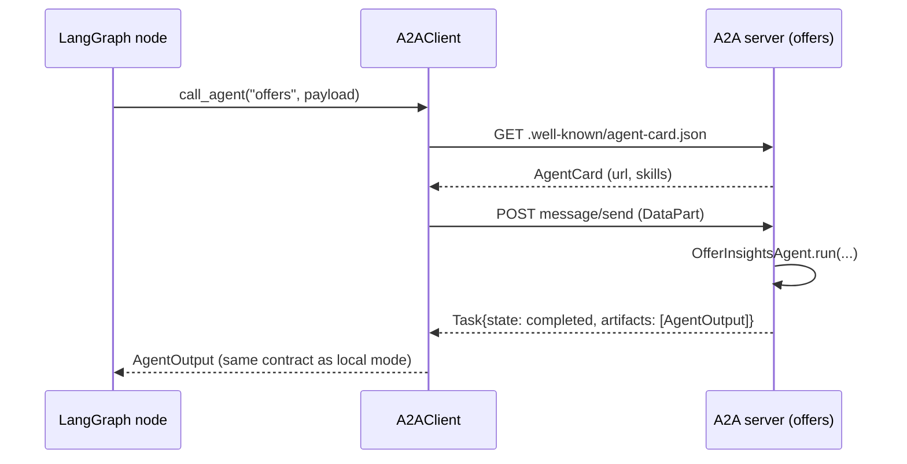

# A2A (Agent2Agent) in this system

Code: [`hiring_intel/a2a.py`](../hiring_intel/a2a.py), kept in its own module on purpose. The graph uses it only when `transport="a2a"`.

## Why A2A here

In-process agents are simplest, but they tie every agent to one Python process and one deploy. A2A lets each insight agent run as an independent service that **describes itself** (Agent Card) and **accepts tasks** over a standard protocol. Then you can:

- scale the slow agent (Rejection) separately from the cheap ones;
- let another team replace an agent (say, a Java Offer agent backed by the comp system) without touching the graph;
- call the same agents from other orchestrators or tools.

MCP and A2A solve different problems: **MCP connects an agent to tools and data** (an ATS API, the vector DB); **A2A connects agents to other agents**. The stretch goal "MCP-style tool integration" would wrap `MockATSClient` and `retrieve()` as MCP tools; A2A wraps whole agents.

## What is implemented (a spec-shaped subset)

| A2A concept | Here |
| --- | --- |
| Agent Card | `GET /agents/<name>/.well-known/agent-card.json`: name, description, url, version, capabilities, skills, input/output modes |
| Agent directory | `GET /agents`: all five cards (convenience, not part of the spec) |
| Transport | JSON-RPC 2.0 over HTTP `POST /agents/<name>/` |
| `message/send` | Input = a `DataPart` with `{data_path, run_id, force_tier, compress, use_cache, last_eval}` |
| Task | Returned synchronously with `status.state` = `completed` or `failed` |
| Artifact | One `DataPart` holding the `AgentOutput` contract |
| `tasks/get` | Fetch a stored task by id |
| Not implemented | streaming (`message/stream`), push notifications, auth schemes, `input-required` multi-turn |

## Run it

```bash
uvicorn hiring_intel.a2a:server --port 8100
curl -s localhost:8100/agents/offers/.well-known/agent-card.json | jq .
A2A_BASE_URL=http://localhost:8100 python scripts/run_pipeline.py --transport a2a
```

In Docker Compose the `a2a` service runs this server and the app reaches it at `http://a2a:8100`.

## Message examples

Request:

```json
{"jsonrpc": "2.0", "id": "1", "method": "message/send",
 "params": {"message": {"role": "user", "kind": "message", "messageId": "m-1", "contextId": "run-42",
   "parts": [{"kind": "data", "data": {"data_path": "data/raw/baseline_medium", "run_id": "run-42"}}]}}}
```

Response (trimmed):

```json
{"jsonrpc": "2.0", "id": "1",
 "result": {"kind": "task", "id": "7f3c...", "contextId": "run-42", "status": {"state": "completed"},
   "artifacts": [{"name": "agent_output", "parts": [{"kind": "data",
     "data": {"agent": "offers", "status": "ok", "insights": [...], "cost_of_insight": {...}}}]}]}}
```

## Sequence



## Moving to the official SDK

The models mirror the A2A spec field names (`protocolVersion`, `skills`, `parts[].kind`, `Task.status.state`), so switching to the official `a2a-sdk` package is mostly mechanical: replace `build_agent_app` with an `AgentExecutor` that calls `AGENTS[name].run(...)` and emits the output as a data artifact, and replace `A2AClient` with the SDK client. Check the SDK version you install; its APIs have changed between releases.

## Security notes before exposing it

- Add an auth scheme to the card and enforce it (API key or OAuth); today the server trusts anyone who can reach it.
- `data_path` is a server-side path: validate it against an allow-list before production.
- Keep the A2A port on the internal Docker network unless another system really needs it.
