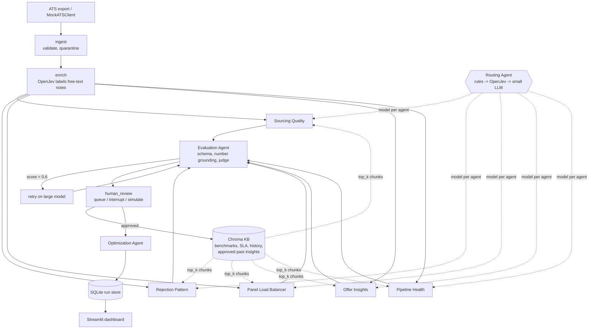

# Architecture

## One-line summary

Pandas computes the numbers, OpenJev makes closed-set decisions, the LLM interprets and recommends, a second agent checks the first, and a human signs off anything that changes pay, headcount or someone's workload.

## Graph

With `transport="a2a"` the five insight agents run behind the A2A server instead of in-process; nothing else in the graph changes.

## Components

| Component | File | Job | Model |
| --- | --- | --- | --- |
| Ingest | `ingest.py` | Load 6 CSVs, parse dates, drop duplicates, referential integrity, quarantine count | none |
| Enrich | `enrich.py` | Fill missing rejection/decline reasons from free-text notes | OpenJev |
| Sourcing Quality | `agents/insight_agents.py` | Channels to grow or cut, per role | routed |
| Rejection Pattern | same | Where/why rejections happen; JD vs sourcing vs interview calibration | routed (usually large) |
| Panel Load Balancer | same | Overloaded/idle interviewers + concrete move plan | routed (usually small) |
| Offer Insights | same | Why offers decline (comp, timing, competing) | routed (usually large) |
| Pipeline Health | same | SLA breaches, aging requisitions, funnel | routed (usually small) |
| Routing Agent | `agents/router.py` | Pick small vs large per agent | rules, OpenJev, small LLM |
| Evaluation Agent | `agents/evaluator.py` | Quality gate | deterministic + judge |
| Optimization Agent | `agents/optimizer.py` | Cheaper/faster suggestions from run stats | small LLM |
| HITL | `hitl.py` | Review policy, queue, decisions, RAG write-back | OpenJev for sensitivity |
| A2A | `a2a.py` | Expose agents as A2A services; client used by the graph | none |

## State and checkpointing

The graph state holds only JSON-able values: the run config (incl. `data_path`), agent outputs as dicts, eval results, review items. DataFrames stay in a per-path cache in `ingest.py`. That keeps checkpoints small and makes `interrupt()`/`resume()` work for human review.

## Error handling per hop

| Hop | Failure | Handling |
| --- | --- | --- |
| Ingest | missing table/column | hard fail with a clear message |
| Ingest | bad rows, orphan events | dropped and counted as quarantined |
| Enrich | low-confidence label | stored as `unclassified`, never forced |
| Retrieval | empty or Chroma error | agent continues, status `degraded`, confidence capped |
| Routing | OpenJev unsure | escalates to a small-LLM decision |
| LLM call | timeout / 429 / 5xx | LiteLLM `num_retries=2`, then agent `failed` |
| LLM JSON | schema violation | one repair turn with the validation error |
| Agent | any exception | caught in `BaseInsightAgent.run`, recorded in `errors` |
| Evaluate | score < 0.6 or failed agent | one retry on the large model |
| Judge | judge call fails | deterministic checks still score it (judge = null) |
| A2A | remote task fails | `failed` AgentOutput with the task id and state |
| UI | failed agent | red card with the error, never hidden |

Two demo switches prove this: `crash_agent="offers"` (agent raises, run recovers on retry) and `inject_fault="sourcing"` (fabricated numbers, evaluator catches them, retry on large).

## Why these choices

- **LangGraph, not n8n:** parallel fan-out + conditional retry + `interrupt()` for HITL, all testable in pytest.
- **Pandas-first features:** the LLM never counts rows; every evidence number can be checked mechanically.
- **OpenJev for closed-set decisions:** labelling thousands of notes or answering yes/no needs no generation; it costs $0 API and is deterministic.
- **Rules-first routing:** a model choosing a model on every call would eat the savings it creates.
- **A2A in its own module:** agents can be deployed and scaled separately or swapped for another team's agent; the graph only knows names and cards.
