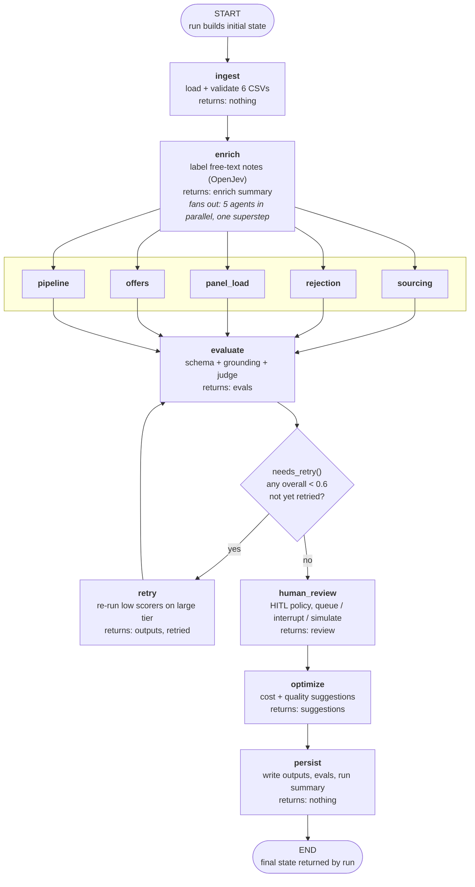
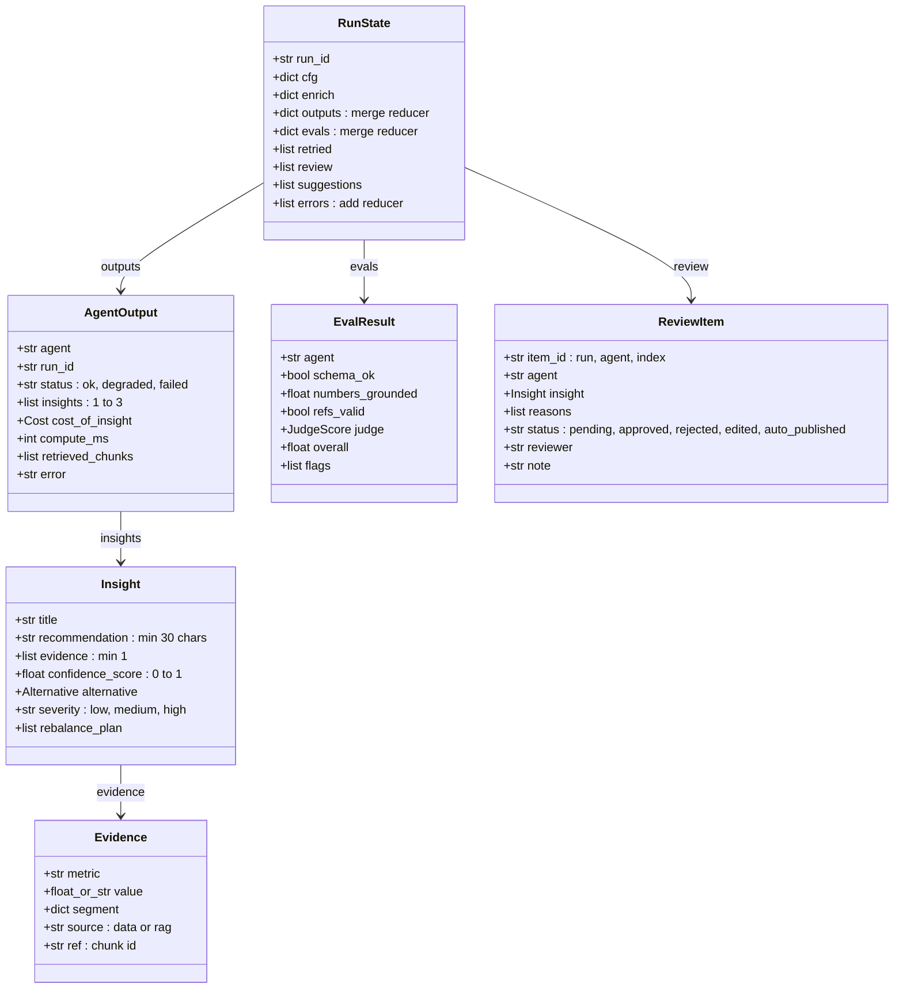
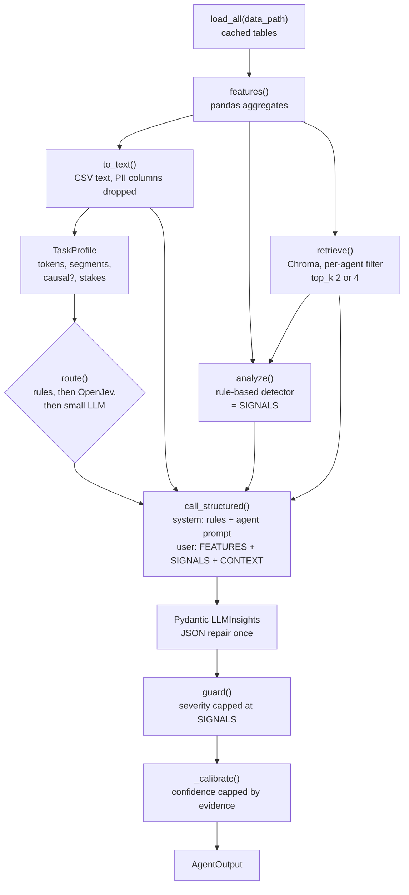
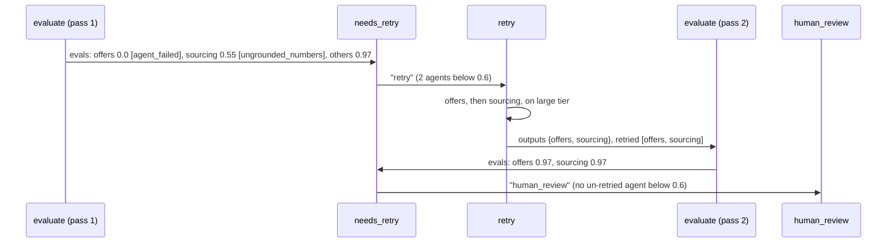
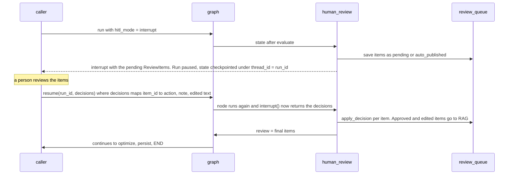

# LangGraph flow: `hiring_intel/graph.py`

What the orchestrator builds, what each node reads and writes, and what the state looks like at every step. All examples and sizes come from real runs:

- **Run A:** `baseline_medium`, `optimized` settings (`compress=True`, `classify="openjev"`), mock LLM, keyword OpenJev. The happy path.
- **Run B:** `baseline_small` with `crash_agent="offers"` and `inject_fault="sourcing"`. The retry path.

A browser version with the same content is in [graph_flow.html](graph_flow.html).

---

## 1. The graph at a glance



| | |
| --- | --- |
| Nodes | 12: `ingest`, `enrich`, 5 agents, `evaluate`, `retry`, `human_review`, `optimize`, `persist` |
| Edges | fan-out `enrich → 5 agents`, fan-in `5 agents → evaluate`, one conditional edge after `evaluate`, one loop `retry → evaluate` |
| Loop bound | each agent is retried **at most once** (`retried` list), so `evaluate` runs at most twice |
| Checkpointer | `InMemorySaver`, keyed by `thread_id = run_id`; needed so `interrupt()` can pause and `resume()` can continue |
| Entry points | `run(...)` starts a run; `resume(run_id, decisions)` continues one paused at `human_review` |

---

## 2. The state: `RunState`

The state carries **only paths, config and JSON-able dicts**. The CSV tables never enter it: `load_all(path)` keeps them in a per-path cache. That keeps each checkpoint around 27 KB even for 84k candidates.



| Field | Type | Reducer | Written by | Read by | Size (run A, final) |
| --- | --- | --- | --- | --- | --- |
| `run_id` | `str` | replace | `run()` | every node (DB rows, logs) | `"flowdoc-medium"` |
| `cfg` | `dict`, 13 keys | replace | `run()` | every node | ~380 B |
| `enrich` | `dict`, 9 keys | replace | `enrich` | dashboard, benchmark | ~240 B |
| `outputs` | `{agent: AgentOutput}` | **`merge`** (dict union, new wins) | 5 agents, `retry` | `evaluate`, `human_review`, `persist` | 5 entries, 1.6–3.0 KB each, ~12 KB |
| `evals` | `{agent: EvalResult}` | **`merge`** | `evaluate` | `needs_retry`, `retry`, `human_review`, `optimize`, `persist` | 5 entries, ~1.6 KB |
| `retried` | `list[str]` | replace | `retry` | `evaluate`, `needs_retry` | `[]` (run A), `["offers","sourcing"]` (run B) |
| `review` | `list[ReviewItem]` | replace | `human_review` | caller, dashboard | 8 items, ~1.5 KB each, ~11.9 KB |
| `suggestions` | `list[Insight]` | replace | `optimize` | caller, dashboard | 2 items, ~1.2 KB |
| `errors` | `list[str]` | **`operator.add`** (append) | 5 agents | caller | `[]` (run A), `["offers: RuntimeError: injected crash"]` (run B) |

**Why the reducers matter.** The five agents run in the same superstep and each returns `{"outputs": {name: ...}, "errors": [...]}`. Without `merge`, the last agent to finish would overwrite the other four. Without `operator.add`, `errors` would keep only one agent's error. `retry` relies on `merge` too: it returns only the re-run agents, and the merge replaces just those entries.

### State size after each step (run A, JSON bytes)

| After | Keys present | Bytes | Grew by |
| --- | --- | --- | --- |
| initial (`run()`) | run_id, cfg, outputs={}, evals={}, errors=[], retried=[] | 395 | |
| `ingest` | same | 395 | 0 (returns `{}`) |
| `enrich` | + `enrich` | 636 | +241 |
| 5 agents (one superstep) | `outputs` filled | 12,688 | +12,052 |
| `evaluate` | `evals` filled | 14,248 | +1,560 |
| `human_review` | + `review` | 26,104 | +11,856 |
| `optimize` | + `suggestions` | 27,338 | +1,234 |
| `persist` | same | 27,338 | 0 (writes to SQLite) |

The state size depends on how many insights there are, **not on how many candidates**. 1.2k or 84k candidates give the same ~27 KB, because agents receive aggregated feature tables, never rows.

---

## 3. Node by node

### 3.0 `run()`: building the initial state

**Input:** function arguments.

```python
run("data/raw/baseline_medium", variant="optimized", compress=True, classify="openjev")
```

**Output (initial state):**

```json
{
  "run_id": "optimized-1023113012-8e53",
  "cfg": {"data_path": "data/raw/baseline_medium", "scenario": "baseline", "size": "medium",
          "variant": "optimized", "force_tier": null, "compress": true, "use_cache": false,
          "classify": "openjev", "hitl_mode": "queue", "transport": "local",
          "inject_fault": null, "crash_agent": null, "started": 130.0079},
  "outputs": {}, "evals": {}, "errors": [], "retried": []
}
```

| `cfg` key | Values | Used by |
| --- | --- | --- |
| `data_path` | folder with the 6 CSVs | every node (via `load_all`) |
| `force_tier` | `null` / `"small"` / `"large"` | agents (skip the Routing Agent) |
| `compress` | `true` / `false` | agents, evaluate (lever B: smaller feature tables, `top_k` 2) |
| `use_cache` | `true` / `false` | agents (lever D: response cache) |
| `classify` | `"openjev"` / `"llm"` | enrich (lever C) |
| `hitl_mode` | `"queue"` / `"interrupt"` / `"simulate"` | human_review |
| `transport` | `"local"` / `"a2a"` | agents (in-process call, or JSON-RPC to the A2A server) |
| `inject_fault`, `crash_agent` | agent name or `null` | agents (demo faults, first pass only) |

If you pass a fixed `run_id`, `purge_run()` first deletes that id's old rows from SQLite, so re-runs don't add up costs.

### 3.1 `ingest`

| | |
| --- | --- |
| **Reads from state** | `cfg.data_path`, `run_id` |
| **Reads from outside** | 6 CSVs: `requisitions`, `candidates`, `stage_events`, `interviews`, `interviewers`, `offers` |
| **Work** | `load_all(path)`: required columns, date parsing, de-duplication, drop orphan events, count quarantined rows; result kept in the per-path cache |
| **Returns** | `{}`: the tables stay out of the state |
| **Side effects** | `timings` row (`stage="ingest"`) |
| **Example input size** | `baseline_medium`: 2.4 MB on disk; 150 requisitions, 6,327 candidates, 14,356 stage events, 7,586 interviews, 100 interviewers, 272 offers |
| **Time** | ~1 s (first load), then cached |

### 3.2 `enrich`

| | |
| --- | --- |
| **Reads** | `cfg.data_path`, `cfg.classify`, `run_id`; the cached tables |
| **Work** | finds rejections with no `rejection_reason` but a `rejection_note`, and declines with no `decline_reason` but a `decline_note`; labels each **unique** note with OpenJev (7 rejection reasons + `unclear`, 4 decline reasons + `unclear`) or, with `classify="llm"`, batches of 50 notes to the small LLM |
| **Mutates the cached tables** | adds `reason` and `reason_source` to `stage_events`, and `reason` to `offers`; Rejection and Offers agents read these |
| **Returns** | `{"enrich": {...}}` |
| **Side effects** | one `decisions` row per unique note; `llm_calls` rows in llm mode; `timings` row |

```json
"enrich": {"classified": 3660, "unique_notes": 25, "backend": "keyword-fallback",
           "compute_ms": 94, "ms_per_unique_note": 4, "llm_equivalent_usd": 0.0878,
           "accuracy_vs_truth": 0.916, "accuracy_when_labelled": 1.0, "escalated_share": 0.084}
```

Time: 94 ms with the keyword fallback. With the real 0.8B OpenJev on a laptop CPU it took 10–39 s per unique note (16 minutes for one run), the biggest stage by far.

### 3.3 The five agent nodes (`make_agent_node(name)`)

All five start from `enrich` in **one superstep** and run concurrently. Each one's node function:

1. calls `_run_agent(name, s)`;
2. logs a `timings` row;
3. returns its own slice of the state.



| | |
| --- | --- |
| **Reads** | `cfg` (`data_path`, `force_tier`, `compress`, `use_cache`, `transport`, `crash_agent`, `inject_fault`), `run_id` |
| **Returns** | `{"outputs": {name: AgentOutput}, "errors": [] or ["name: <error>"]}` |
| **Never raises** | any exception becomes `status="failed"` with `error`; the graph carries on |
| **Status** | `ok`; `degraded` if RAG returned no chunks; `failed` |
| **Side effects** | `routing` row, `llm_calls` row, `decisions` rows (routing tie-break), `timings` row |
| **A2A** | with `transport="a2a"`, the same work runs behind `POST /agents/<name>` (JSON-RPC `message/send`); the node receives the same `AgentOutput` |

**Prompt and output size per agent (run A, compressed):**

| Agent | Feature table | RAG chunks | Signals | Tier (decided by) | In tokens | Out tokens | USD | LLM latency* | Output size |
| --- | --- | --- | --- | --- | --- | --- | --- | --- | --- |
| sourcing | 838 chars, 26 rows | `bench_sourcing_backend`, `bench_sourcing_sre` | 2 | small | 1,473 | 620 | 0.00059 | 6.8 s | 3.0 KB |
| rejection | 1,248 chars, 45 rows | `rej_playbook`, `rej_hist_q1` | 2 | large | 1,548 | 528 | 0.00915 | 11.5 s | 2.6 KB |
| panel_load | 616 chars, 19 rows | `load_policy`, `past_insight_panel` | 1 | small | 1,276 | 517 | 0.00050 | 5.7 s | 2.6 KB |
| offers | 403 chars, 20 rows | `offer_timing`, `comp_bands` | 1 | large | 1,238 | 300 | 0.00610 | 6.5 s | 1.6 KB |
| pipeline | 247 chars, 16 rows | `sla_policy`, `pipeline_ttf` | 2 | small | 1,180 | 464 | 0.00046 | 5.0 s | 2.3 KB |

\* simulated in mock mode from `config/models.yaml`. The superstep's latency is the **slowest** agent (rejection, 11.5 s), not the sum.

**Example: what the sourcing agent sends (user message, abridged):**

```text
FEATURES (computed from ATS data):
role,source,applicants,hire_rate,onsite_rate
Backend,job_board,294,0.02,0.095
Backend,referral,241,0.191,0.519
Data,agency,250,0.008,0.04
...                                   (25 rows)

SIGNALS (passed thresholds in code):
- [high] Backend: referral out-converts job_board | onsite_rate=0.519 (role=Backend, source=referral); onsite_rate=0.095 (role=Backend, source=job_board); ...
- [medium] Data: referral out-converts agency | onsite_rate=0.143 (role=Data, source=referral); onsite_rate=0.04 (role=Data, source=agency); ...

CONTEXT (retrieved):
[bench_sourcing_backend] Sourcing benchmark (illustrative) for Backend roles. Referral-to-hire ...
```

**Example: one `AgentOutput` in `outputs` (abridged):**

```json
"sourcing": {
  "agent": "sourcing", "run_id": "flowdoc-medium", "status": "ok",
  "insights": [{
    "title": "Backend: referral out-converts job_board",
    "recommendation": "Recruiting lead for Backend: shift 20% of job_board effort to referral this quarter. 51.9% of referral applicants reach onsite vs 9.5% from job_board; re-check after 50 new applicants.",
    "evidence": [
      {"metric": "onsite_rate", "value": 0.519, "segment": {"role": "Backend", "source": "referral"}, "source": "data", "ref": null},
      {"metric": "onsite_rate", "value": 0.095, "segment": {"role": "Backend", "source": "job_board"}, "source": "data", "ref": null},
      {"metric": "hire_rate", "value": 0.191, "segment": {"role": "Backend", "source": "referral"}, "source": "data", "ref": null},
      {"metric": "applicants", "value": 241.0, "segment": {"role": "Backend", "source": "referral"}, "source": "data", "ref": null},
      {"metric": "benchmark", "value": "Sourcing benchmark (illustrative) for Backend roles. Referral-to-hire conversion is typically 8-12%...", "segment": {}, "source": "rag", "ref": "bench_sourcing_backend"}
    ],
    "confidence_score": 0.95,
    "alternative": {"option": "Rules only (no LLM)", "trade_off": "Same thresholds and numbers at $0 and ~0 ms, but no narrative...", "est_usd": 0.0},
    "severity": "high", "rebalance_plan": []
  }, {"title": "Data: referral out-converts agency", "...": "..."}],
  "cost_of_insight": {"model": "gpt-4o-mini", "tier": "small", "input_tokens": 1473, "output_tokens": 620,
                      "usd": 0.000593, "latency_ms": 6848, "simulated": true, "cached": false},
  "compute_ms": 4286,
  "retrieved_chunks": ["bench_sourcing_backend", "bench_sourcing_sre"],
  "error": null
}
```

Typical lengths in run A: 1–2 insights per agent (8 in total), 3–5 evidence items per insight, titles 23–51 characters, recommendations 119–226 characters. Panel Load also fills `rebalance_plan`, for example `{"from_interviewer": "I0002", "to_interviewer": "I0082", "slots_per_week": 9.1}`.

**A failed agent (run B, `crash_agent="offers"`):**

```json
{"outputs": {"offers": {"agent": "offers", "run_id": "flowdoc-faults", "status": "failed", "insights": [],
                        "cost_of_insight": null, "compute_ms": 0, "retrieved_chunks": [],
                        "error": "RuntimeError: injected crash"}},
 "errors": ["offers: RuntimeError: injected crash"]}
```

### 3.4 `evaluate`

| | |
| --- | --- |
| **Reads** | `outputs`, `evals`, `retried`, `cfg.compress`, `run_id` |
| **Which agents** | those without an eval yet, plus those just retried. The first pass evaluates all 5; after `retry` it evaluates only the retried ones |
| **Work, cheapest first** | 1. schema (already enforced by Pydantic); 2. grounding: every numeric `data` evidence value must appear in that agent's feature text (±0.0015, or as a percentage ±0.5), and every `rag` ref must be in `retrieved_chunks`; 3. judge: LLM rubric (real mode), or heuristic + OpenJev "is this actionable?" (mock) |
| **Score** | `overall = 0.35·grounded + 0.15·refs_ok + 0.5·judge`; capped at **0.55** when `grounded < 0.8`; `0.0` for a failed agent |
| **Flags** | `ungrounded_numbers`, `invalid_rag_ref`, `hallucination_risk`, `agent_failed` |
| **Returns** | `{"evals": {agent: EvalResult, ...}}`, merged into existing evals |

```json
"sourcing": {"agent": "sourcing", "schema_ok": true, "numbers_grounded": 1.0, "refs_valid": true,
             "judge": {"actionability": 4, "grounding": 5, "hallucination_risk": 1,
                       "rationale": "heuristic judge (mock mode): actionability p=0.77, grounded=1.00",
                       "judge": "heuristic+openjev"},
             "overall": 0.97, "flags": []}
```

Run B first pass: `offers 0.0 [agent_failed]`, `sourcing 0.55 [ungrounded_numbers]` (grounded 0.71, the three invented numbers), and the other three 0.97.

### 3.5 `needs_retry` (conditional edge, not a node)

```python
low = [a for a, r in s["evals"].items() if r["overall"] < 0.6 and a not in s["retried"]]
return "retry" if low else "human_review"
```

Run A: everything is 0.97, so it goes to `human_review`. Run B: `offers` and `sourcing` are below 0.6, so it goes to `retry`.

### 3.6 `retry`

| | |
| --- | --- |
| **Reads** | `evals`, `retried`, `cfg` |
| **Work** | re-runs each low scorer **sequentially** with `force_tier="large"` and `last_eval=<its score>`. Demo faults apply only on the first pass, so the crash and the invented numbers don't repeat |
| **Returns** | `{"outputs": {only the re-run agents}, "retried": retried + low}` |
| **Then** | back to `evaluate`, which scores only these agents; `needs_retry` can't pick them again |



Run B's state grows by 4.7 KB at `retry` (two new outputs replace the old ones) and 0.6 KB at the second `evaluate`.

### 3.7 `human_review`

| | |
| --- | --- |
| **Reads** | `outputs` (failed ones skipped), `evals` (flags), `cfg.hitl_mode`, `run_id` |
| **Work** | for every insight, `review_reasons()` checks: confidence < 0.6; severity `high`; any eval flag; OpenJev yes/no "does this change compensation, headcount or a person's workload or role?". No reason means `auto_published`, otherwise `pending` |
| **Modes** | `queue`: the run finishes and pending items wait in the dashboard; `interrupt`: the graph **pauses** here; `simulate`: a scripted reviewer decides (benchmarks) |
| **Returns** | `{"review": [ReviewItem, ...]}`, read back from the `review_queue` table so it includes any decisions |
| **Side effects** | `review_queue` rows; `decisions` rows (sensitivity check); approved or edited items are written to RAG as `past_insight` |

Run A: 8 items, 6 `pending` and 2 `auto_published`. One pending item:

```json
{"item_id": "flowdoc-medium:offers:0", "run_id": "flowdoc-medium", "agent": "offers",
 "insight": {"title": "Offers below 90% of expected CTC are being declined",
             "recommendation": "Comp partner and hiring managers: set an offer floor of 90% of the candidate's expected CTC, with exceptions approved within 48 hours. Offers under that line decline at 71% vs 27% in the 0.9-1.0 band.",
             "...": "..."},
 "reasons": ["severity high", "sensitive change (openjev p=0.836)"],
 "status": "pending", "reviewer": null, "note": null}
```

**Interrupt mode: pause and resume**



`decisions` example: `{"flowdoc-medium:offers:0": {"action": "approved", "note": "floor agreed with comp"}}`. `action` is `approved`, `rejected` or `edited`; `edited` also takes `edited_recommendation`.

The checkpointer is in memory, so `resume()` must run in the same process. For a resume across processes, build the graph with `SqliteSaver`.

### 3.8 `optimize`

| | |
| --- | --- |
| **Reads** | `run_id` (its `llm_calls` rows from SQLite), `evals` |
| **Work** | rule hits over per-agent cost and quality (for example, a large-tier agent scoring ≥ 0.8 means "trial the small model"; many note-labelling LLM calls mean "move to OpenJev"), then one small-LLM call writes them up as `Insight`s |
| **Returns** | `{"suggestions": [Insight, ...]}` |

Run A returned 2 suggestions: "Trial the small model for rejection" and "Trial the small model for offers". Evidence is the agent's USD and input tokens, for example `{"metric": "usd", "value": 0.00915, "segment": {"agent": "rejection"}}`.

### 3.9 `persist`

| | |
| --- | --- |
| **Reads** | `outputs`, `evals`, the whole state |
| **Work** | one `agent_outputs` row and one `eval_results` row per agent; `summarize_run()` writes the `runs` row: total USD, calls, tokens, E2E latency on the critical path, mean eval, HITL counts |
| **Returns** | `{}` |

Then `END`: `run()` returns the final state (27 KB in run A) to the caller.

---

## 4. Supersteps and latency

LangGraph runs nodes in **supersteps**: every node whose inputs are ready runs in the same step, and all their updates are applied together through the reducers.

| Superstep | Nodes | Run A latency contribution |
| --- | --- | --- |
| 1 | ingest | ~1.0 s |
| 2 | enrich | 0.1 s (keyword) / ~16 min (real OpenJev, CPU) |
| 3 | sourcing, rejection, panel_load, offers, pipeline | **max** of the five = 11.5 s (rejection, simulated) |
| 4 | evaluate | 0.2 s |
| (5) | retry, then evaluate again | only when something scored < 0.6 |
| 5 | human_review | 0.02 s (keyword) / ~2 min (real OpenJev) |
| 6 | optimize | 0.02 s + one small-LLM call |
| 7 | persist | ms |

E2E latency = ingest + enrich + **max(agents)** + evaluate + max(retry) + review + optimize, which is why parallel fan-out matters and why `report.e2e_latency_ms()` computes the critical path rather than adding everything up.

---

## 5. Where data lives

| Lives in | What | Why |
| --- | --- | --- |
| **Graph state** (checkpointed) | config, enrich summary, agent outputs, evals, review items, suggestions | small, JSON-able, needed for interrupt/resume |
| **`load_all` cache** (process memory) | the six pandas tables, enriched in place | too big for checkpoints; shared by all nodes in the process |
| **SQLite `data/runs.db`** | `runs`, `llm_calls`, `decisions`, `timings`, `routing`, `agent_outputs`, `eval_results`, `review_queue` | the audit trail; the dashboard, benchmark and optimizer read it |
| **Chroma `data/chroma`** | knowledge base + approved past insights | RAG; persists across runs |

---

## 6. Outside the graph: the Ask path

The dashboard's **Ask** tab doesn't run this graph. `hiring_intel/ask.py` answers one HR question on demand, using the same building blocks: the agents' `features()` and `analyze()`, `retrieve()`, the Routing Agent, `call_structured`, `guard()`, `grounding_check()` and `hitl.review_reasons()`. It writes to the same SQLite tables under an `ask_id`, plus its own `questions` table. Flow and contract: [ASK.md](ASK.md).

## 7. Try it

```bash
# watch each node's update as it happens
LLM_BACKEND=mock OPENJEV_BACKEND=fallback python - <<'EOF'
import json, time
from hiring_intel.graph import build
cfg = dict(data_path="data/raw/baseline_small", scenario="", size="", variant="demo", force_tier=None,
           compress=True, use_cache=False, classify="openjev", hitl_mode="queue", transport="local",
           inject_fault="sourcing", crash_agent="offers", started=time.perf_counter())
g = build()
for upd in g.stream({"run_id": "flow-demo", "cfg": cfg, "outputs": {}, "evals": {}, "errors": [], "retried": []},
                    {"configurable": {"thread_id": "flow-demo"}}, stream_mode="updates"):
    for node, u in upd.items():
        print(f"{node:12} -> {list((u or {}).keys())}  {len(json.dumps(u or {}, default=str)):,} bytes")
EOF
```
